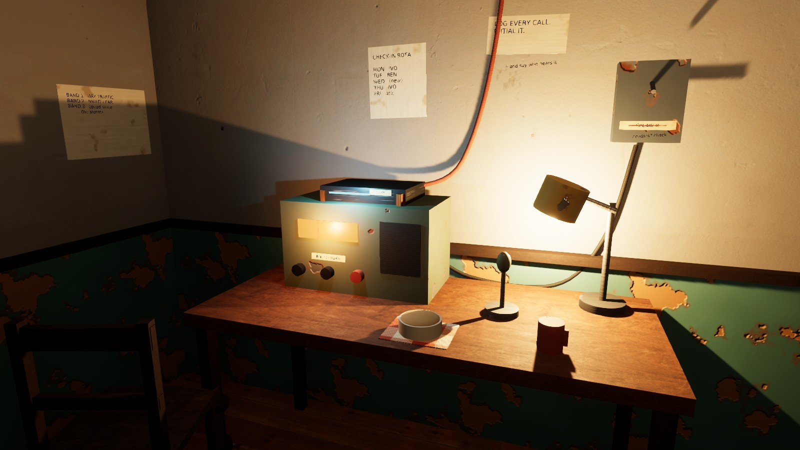
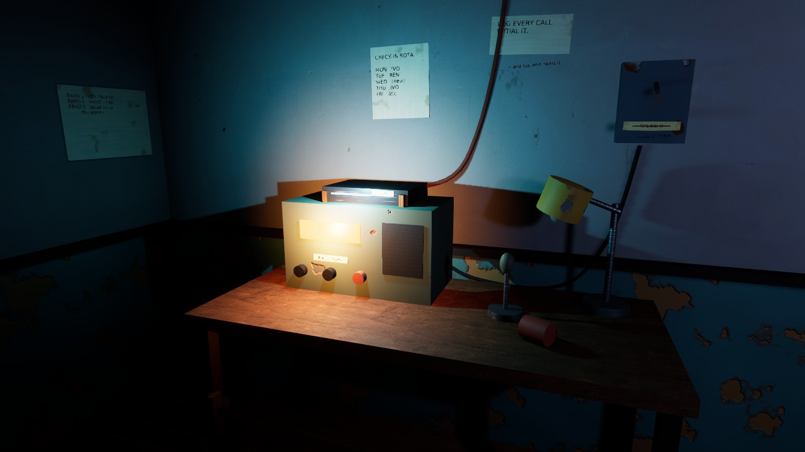
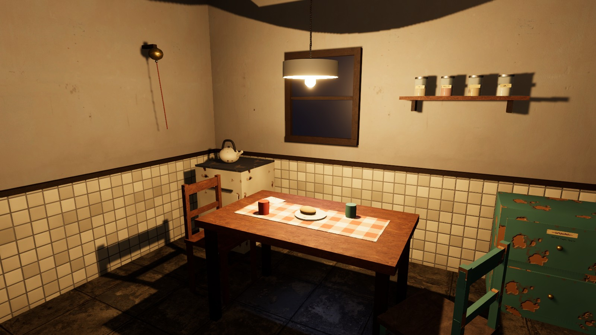
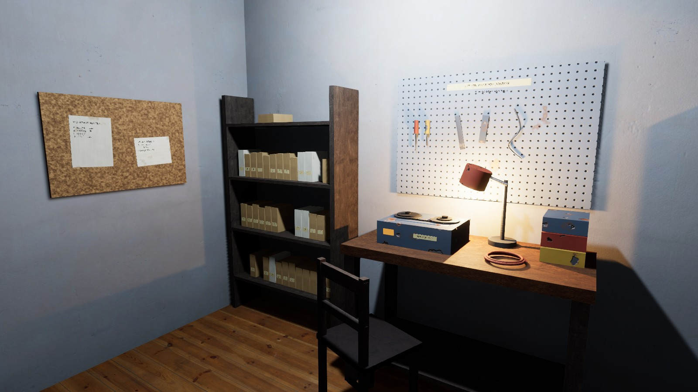
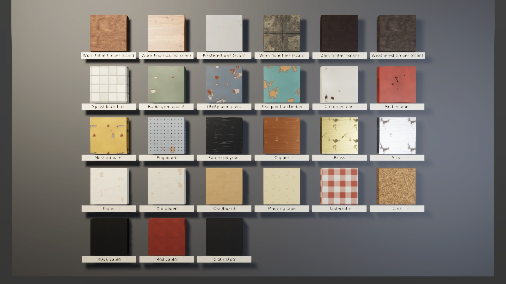

# Style Board v0.2

[Project home](README.md) · Proposed visual studies for owner review. Nothing here approves a
style, palette, prop, or piece of world canon. Names on notes and labels are placeholders.

v0.2 re-renders the same studies after the owner asked for a very high level of realism. The
project now renders with HDRP in linear colour ([D-20](decisions-and-open-questions.md)).
Following D-21, four CC0 scans from Poly Haven replace the largest procedural surfaces:

| Scan | Used for |
|---|---|
| `wood_table_worn` | Desk, table, bench, shelf, and chair timber; darkened for frames and legs, greyed for shelving and salvage |
| `wood_floor_worn` | Radio room and archive floors |
| `plastered_wall_04` | All walls above the wainscot |
| `worn_tile_floor` | Kitchen floor |

Everything else is still generated by Editor code in `Assets/Editor/StyleBoard/`. The scan
files, their authors, and their hashes are listed in the
[provenance manifest](../development/asset-provenance.json). The studies build in their own
scene; `OutpostBlockout.unity` is unchanged. They follow the
[art direction brief](art-audio-and-ux-direction.md): worn timber, painted metal, salvaged
furniture, handwritten revisions, cables that go somewhere, and repairs made more than once.

Lights now use physical units (lumens), and each study has a fixed exposure. Labels and notes
are lit by the scene rather than glowing. The v0.1 renders are kept under
[`style-board/v0.1/`](style-board/v0.1/radio-desk.jpg) for comparison; each study links to its
earlier version.

## Studies

### Radio desk



An older receiver with a newer module strapped to it with copper, a replacement red knob, a
splinted desk leg, and a switch whose printed label has been corrected by hand. Covered food
and a mug stand in for care from a resident. Warm lamp light and cool equipment glow share
the scene. [v0.1](style-board/v0.1/radio-desk.jpg)

### Radio desk, later



The same desk with one routine changed: the lamp is off, the food is gone, the mug is on its
side, and the chair has been pushed back. This tests the brief's question of whether an
altered routine can create unease without a visual horror effect. The exposure is set for a
darker room, so the dial and module light carry the scene.
[v0.1](style-board/v0.1/radio-desk-later.jpg)

### Kitchen table



A pendant over a table with mismatched chairs, one repainted with a replacement seat. It
also has a re-wrapped kettle handle, a kitchen bell with a pull cord, jars with taped labels,
and a drawer label crossed out and rewritten. Cold light from the night window meets the
warm pendant. [v0.1](style-board/v0.1/kitchen-table.jpg)

### Archive and workshop



Shelves of tape boxes with handwritten spines, a reel-to-reel machine marked "slow speed
only", a shared tool board whose rule has an added clause, and a cork board with a roster
and relay sketch. A cool overhead tube lights the room, and a warm task lamp lights the
bench. [v0.1](style-board/v0.1/archive-workshop.jpg)

## Materials and palette



The first six swatches are scans: four as downloaded, plus the table scan darkened and greyed.
The other 21 are generated at 512 px from fixed integer seeds: plaster tiles, chipped paints
and enamels over metal or timber, tarnished metals, paper, card, tape, cloth, cork, and cable.
All use HDRP/Lit with albedo, normal, and mask maps. Scans are tiled at their measured size,
because the study meshes have UVs in metres. [v0.1 swatches](style-board/v0.1/material-swatches.jpg)


| Entry | Hex | Proposed use |
|---|---|---|
| HoneyTimber | `#9A6A3C` | Tables, desk, shelves |
| DarkTimber | `#4A2E1C` | Frames, rails, legs |
| GreyTimber | `#8A7F70` | Weathered and salvaged wood |
| PlasterCream | `#CBBF9F` | Walls |
| KitchenTeal | `#4F7F7A` | Kitchen paint, wainscot |
| EnamelCream | `#D9D0B8` | Stove, bowls, tiles |
| EnamelRed | `#9C3A28` | Mugs, replacement parts |
| Mustard | `#B88D36` | Lamp shades, parts bins |
| RadioGreen | `#56614F` | Older receiver housings |
| UtilityBlue | `#4C5A66` | Switch boxes, tape machine |
| FuturePolymer | `#17191C` | Surviving newer equipment |
| IndicatorCyan | `#58D6E6` | Newer equipment indicators |
| DialAmber | `#FFA040` | Older dials and meters |
| MaskingTape | `#D2BD85` | Handwritten labels |
| Copper | `#B87348` | Straps, repairs |
| Brass | `#B59A52` | Bell, knobs |
| Paper | `#E6DCC3` | Notes |
| Cardboard | `#A88557` | Tape boxes |
| Ink | `#1F2430` | Original writing |
| RedInk | `#8C2020` | Later corrections |
| PencilGrey | `#4D4D4D` | Labels |

## Review questions

1. Is this the right level of realism? Scanned surfaces make the generated props, which are
   still boxes and cylinders, look simpler by comparison. Should the next step be modelled
   props, or more scans?
2. Does the mix of older painted equipment, black polymer modules, and copper-strap repairs
   read as an alternate future after collapse, or as generic mid-century? The answer depends
   partly on Q-02 (what infrastructure survives and how long ago collapse happened).
3. Should corrections in a second ink stay a recurring motif for competing revisions and
   shared knowledge? If so, should residents have their own hands or colours?
4. Does "Radio desk, later" feel uneasy enough through absence alone?
5. Is warm household light against cool equipment light worth keeping as a tendency? The
   brief treats it as optional and not as a safety/danger code.
6. Do the scans fit the palette, or should they be tinted toward it? The table scan is lighter
   and redder than the proposed honey timber, and the plaster is cooler than the proposed cream.

## Known limits

- Props are built from boxes, cylinders, spheres, and tubes. There are no bevels, cloth
  simulation, sculpted forms, or characters. Next to the scans, the generated timber grain and
  paint chips look more synthetic than they did in v0.1.
- Indirect light is approximated by an unshadowed fill light and a dim gradient sky. There are
  no reflection probes, baked lighting, or screen-space reflections, so metals and glass reflect
  the sky rather than the room.
- Label text uses Unity's built-in sans-serif font rather than handwriting, and small labels
  are hard to read at this resolution.
- Scans are 2K JPGs. Close-ups will show compression and resolution limits.
- No audio is included.

## Reproduce

```sh
git lfs pull
python3 scripts/capture_style_board.py
```

The command copies the project into a disposable directory, runs
`CommonHouse.Editor.StyleBoard.StyleStudies.Capture` in the pinned Editor with a graphics
device, and fails if an image or inventory file is missing, or if an image is nearly uniform.
That last check catches a render that has failed entirely, as v0.1 did under HDRP. It cannot
judge quality, so inspect the images. Output stays under
`~/.local/state/common-house-unity/style-board-*`. In the Editor, **Common House → Style
Board → Build Studies In New Scene** builds the same studies in an unsaved scene.

The committed images come from source revision `935c42a` on Kvant (AMD Radeon RX 7900 XT,
Vulkan, RADV NAVI31, Mesa 26.2.2). Two earlier runs of the same code produced byte-identical
kitchen and swatch images, while the other three differed. Expect small differences between
runs as well as between GPUs.
