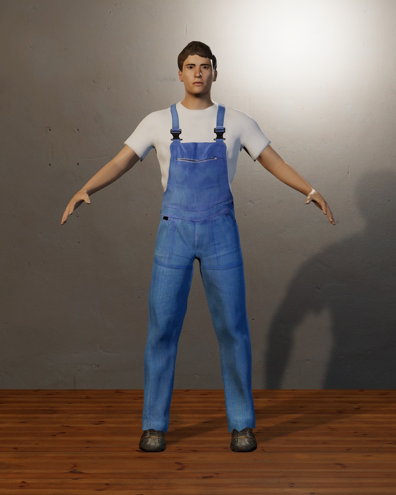
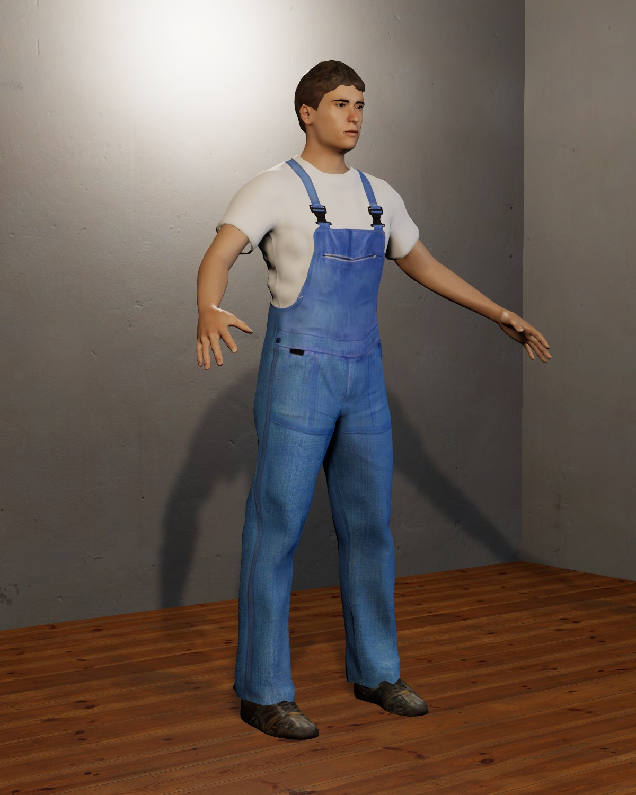
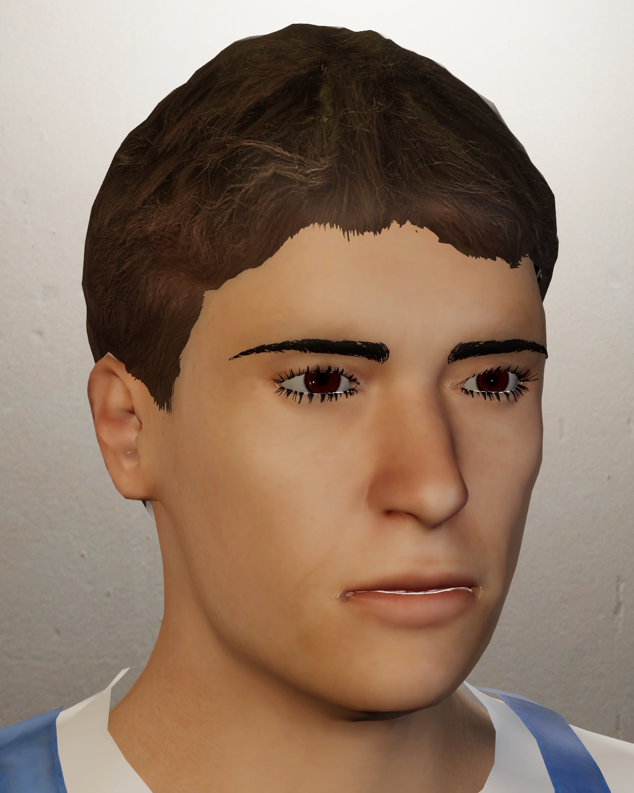

# Characters

Residents are generated with MPFB2, the MakeHuman add-on for Blender, from JSON recipes kept in
this repository (decision [D-23](../design/decisions-and-open-questions.md)). The owner does not
model or animate. Rebuilding a recipe with the same pinned tools gives the same character, and a
new recipe gives a new resident that matches the others.

## Setup

```sh
python3 scripts/characters.py setup
```

This downloads Blender 4.5.14 LTS, MPFB 2.0.17, and the MakeHuman CC0 asset packs
`makehuman_system_assets`, `skins01`, and `skins02`. Each download is checked against a SHA-256
pinned in `scripts/characters.py`. Blender goes to `~/.local/opt/`, downloads are cached in
`~/.cache/common-house-blender/`, and MPFB and the packs go into a Blender profile used only by
this project (`~/.local/share/common-house-blender/`). Your normal Blender settings are not
touched. `download.blender.org` may block scripted downloads, so the script uses an official
mirror first.

## Recipes

A recipe in `tools/characters/recipes/<id>.json` sets body shape and names MakeHuman assets by
their path inside the asset packs:

```json
{
  "id": "test-resident-01",
  "phenotype": {"gender": 1.0, "age": 0.62, "muscle": 0.5, "weight": 0.55, "proportions": 0.6,
                "height": 0.55, "race": {"african": 0.1, "asian": 0.1, "caucasian": 0.8}},
  "skin": "middleage_caucasian_male/middleage_caucasian_male.mhmat",
  "eyes": "high-poly/high-poly.mhclo",
  "eyebrows": "eyebrow001/eyebrow001.mhclo",
  "eyelashes": "eyelashes01/eyelashes01.mhclo",
  "teeth": "teeth_base/teeth_base.mhclo",
  "tongue": "tongue01/tongue01.mhclo",
  "hair": "short02/short02.mhclo",
  "clothes": ["male_worksuit01/male_worksuit01.mhclo", "shoes02/shoes02.mhclo"],
  "rig": "game_engine"
}
```

Phenotype values run from 0 to 1, as in MPFB's sliders. The installed packs provide 10
hairstyles, 12 eyebrows, 4 eyelash sets, 59 skins (including a toon skin and some with makeup, tattoos, or genitals, which are unsuitable), and 20 clothing and shoe items;
their folders are under the profile's `extensions/.user/user_default/mpfb/data/`. `test-resident-01`
is a pipeline test, not a Case 01 resident.

## Building

```sh
python3 scripts/characters.py build            # every recipe
python3 scripts/characters.py build <id> ...   # named recipes
```

For each recipe, `tools/characters/mpfb_build.py` runs in Blender. It builds the character,
removes body faces hidden under clothes, and exports `<id>.fbx` with MPFB's game-engine rig. It
also writes `<id>.character.json`, which lists each material's part type and textures. Output
goes to `Assets/CommonHouse/Art/Characters/<id>/`. Textures go to
`Assets/CommonHouse/Art/Characters/Textures/` at their path inside the packs, so characters share
one copy of each. The build adds provenance entries: `generated` for the FBX, and `cc0` for each
texture, with MakeHuman's pack page and the copyright holders named in the asset file.

In Unity, `CommonHouse.Editor.CharacterAssets.Prepare` imports the FBX as a humanoid and builds
HDRP/Lit materials from the character description. Skin uses subsurface scattering with HDRP's
skin diffusion profile. Hair, eyebrows, eyelashes, and eyes are alpha-clipped. Clothing normal
maps are applied. Run it on a disposable copy and bring the results back with:

```sh
python3 scripts/run_editor_method.py CommonHouse.Editor.CharacterAssets.PrepareAll --copy-back
```

## Retro characters

The D-24 look uses low-poly characters like late-1990s console games, with face, clothes, and
hair painted into one small texture rather than modelled:

```sh
python3 scripts/characters.py retro            # every recipe
python3 scripts/characters.py retro <id> ...
```

For each recipe, `tools/characters/retro_bake.py` builds the detailed character and fits MPFB's
`proxy741` body (730 faces). It keeps the proxy whole under the clothes, and bakes the detailed
character's colour onto the proxy's UVs with Cycles. The bake is 1024 px, shrunk to 128 px. The
FBX (game-engine rig and proxy), the texture, and a small description go to
`Assets/CommonHouse/Art/Characters/Retro/<id>/`, with `generated` provenance entries. `RetroLook`
imports them as humanoids with one retro material each.

Hair is painted onto the head, and eyes and teeth are part of the texture. Pick hair and clothes by
their colour at small size: `bob02`, for example, is dyed teal, which read as white.

## Review capture

```sh
python3 scripts/capture_characters.py
```

This renders every character in a plaster corner under three lights, from the front, at three
quarters, and at the face. It writes `character-inventory.txt` with each character's humanoid
status and materials. The command fails if an image is missing. Inspect the images.

## Test resident

Rendered on Kvant on 2026-09-28 from an uncommitted tree based on `2ad5783` (evidence
`characters-20260928T172330Z-1eg4l_xk`). The avatar is a valid humanoid, and all nine parts use
project materials.







## Known limits

- Realism is game-quality rather than photographic. Hair is a textured cap, not strands. System
  skins have a colour map only, without normal or roughness maps. Eyebrows are dark and flat.
- Characters stand in MPFB's A-pose. There is no animation or idle pose yet; the game-engine rig
  maps to Unity's humanoid rig, so humanoid animation clips can be retargeted.
- Hair and clothing choices are limited to the installed packs. More CC0 packs exist, and each
  would be added to the pins in `scripts/characters.py`.
- The recipe's `age` of 0.62 reads younger than intended. MakeHuman's age scale is not linear in
  years, so values need tuning by eye.
- One test character is about 25 MB, mostly shared textures. Later characters that reuse eyes,
  teeth, and clothing add less.
