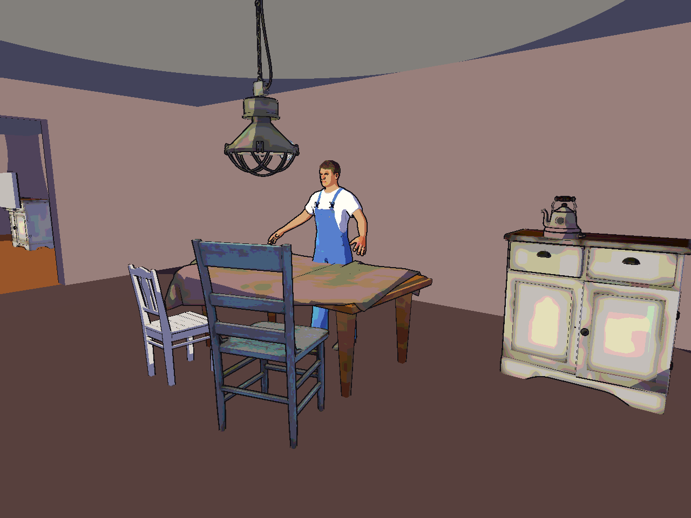
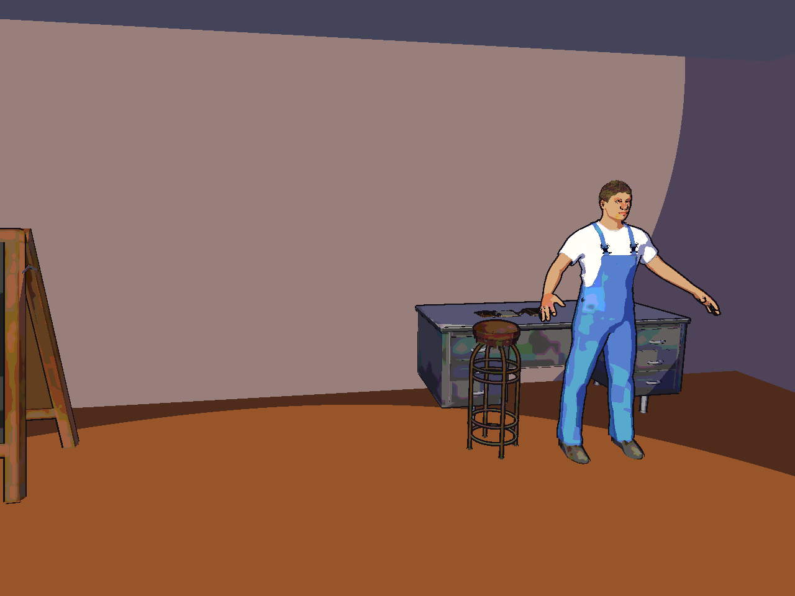
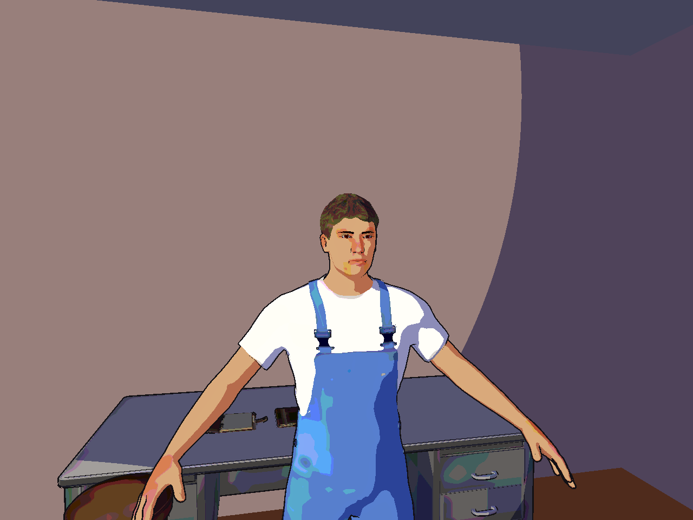
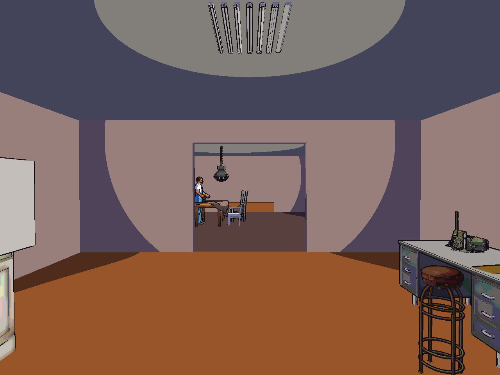

# 1990s anime aesthetic experiment

Issue #73, on the branch `experiment/anime`, stacked on the
[isometric experiment](isometric.md). It proposes a look and does not approve one.

1990s TV anime such as Serial Experiments Lain painted rooms as flat colour, lit characters in
two tones, and drew ink lines around them. Lain's quiet domestic rooms, networked machines, and
unease are close to this project's themes. This experiment keeps the realistic outpost, props, and
detailed test resident, and draws every surface with a new HDRP shader, `CommonHouse/Anime`:

- Colour is flattened. Walls, floors, and ceilings take their texture's average colour. Props
  and characters sample a blurred mip level and are posterised to a few levels per channel.
- Light is cut into two tones: lit, or a shadow tint (cool on objects, warm on skin), from the
  same point-light globals as the PS1 experiment.
- A second pass draws an ink outline by pushing back faces outwards. Hair, lash, and glass cards
  have no outline.

```sh
python3 scripts/style_experiment.py build anime
python3 scripts/style_experiment.py capture anime
```

## Frames









## Known limits

- The resident has realistic MPFB proportions and a realistic skin texture, flattened. It reads
  as a cel-shaded person rather than an anime character. Anime characters would need different
  models: larger eyes, simplified features, stylised proportions.
- Props still show blotches where posterising meets stained scans. Hand-painted or flat-colour
  prop textures would fix this.
- Lamp light shows as hard circles on walls and ceilings. A painter would place those shapes
  deliberately.
- There are no painted background details, screentones, or film grain. The look exists only in
  the review capture, not in play.
