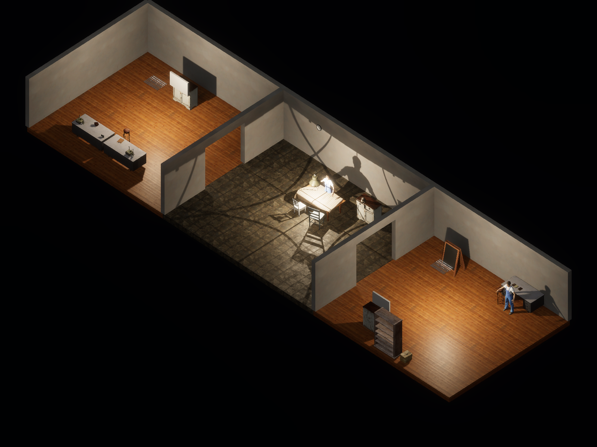
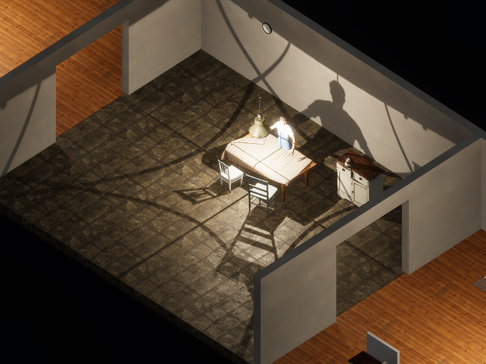
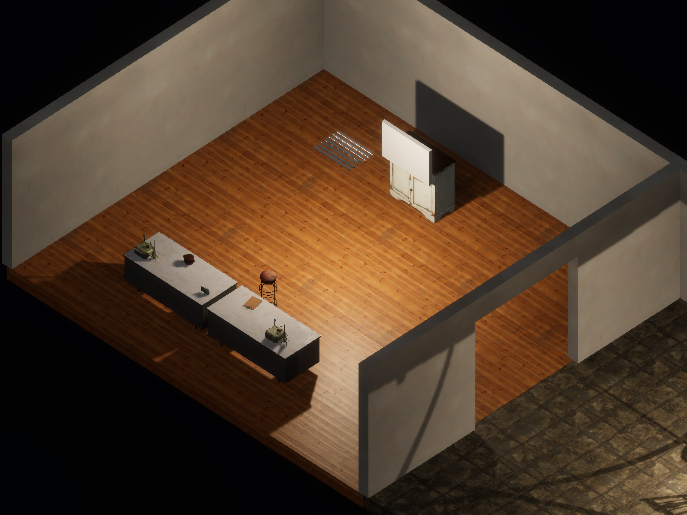
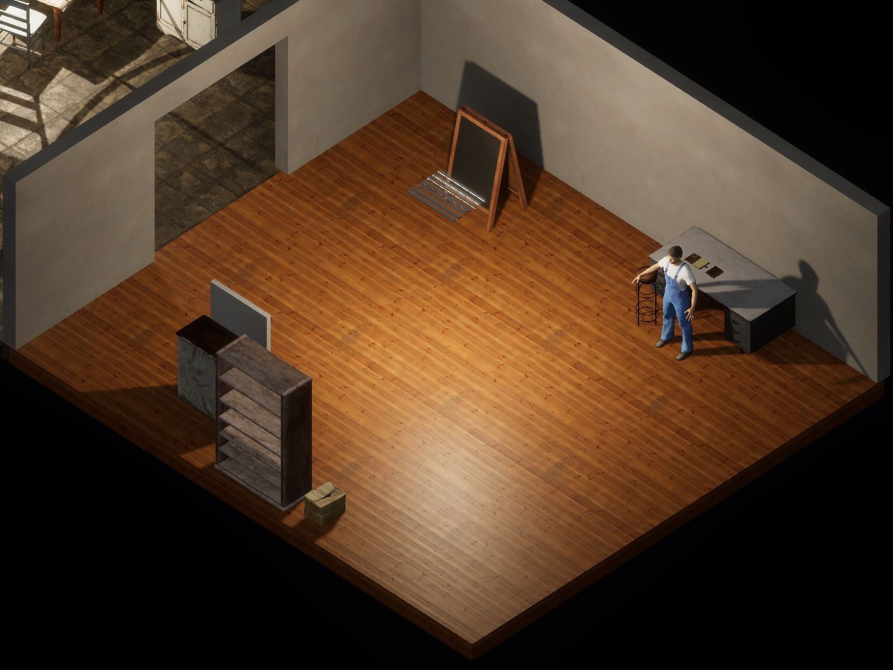

# Isometric RPG view experiment

Issue #72, on the branch `experiment/isometric`, stacked on the
[pre-rendered experiment](prerendered.md). It proposes a view and does not approve one.

Disco Elysium, Fallout, and similar isometric RPGs show rooms from above at a fixed angle, with
the nearest walls and ceilings cut away. This experiment keeps the realistic outpost and places
the detailed test resident at the two resident positions. It hides the ceilings and the south and
east walls, and renders with an orthographic camera looking north-west from 40° above.

```sh
python3 scripts/style_experiment.py build isometric
python3 scripts/style_experiment.py capture isometric
```

## Frames









## What it would mean for the game

This is a camera and genre question as much as a look. An isometric view suits the project's
investigation and conversation focus in the way Disco Elysium does. The whole household is
visible, routines and absences can be read at a glance, and dialogue can take more of the screen.
It would replace the current first-person movement, inspection, and occlusion rules with
click-to-move or direct movement. Much of the current interaction code and many of the PlayMode
tests assume first person.

The detailed characters work at this distance. Their A-pose and lack of animation show more here
than in close shots.

## Known limits

- Wall cutaways are fixed. A real game would hide whichever walls face the current camera.
- No painterly treatment was tried; Disco Elysium's look depends heavily on painted textures.
- Residents stand in the A-pose. The look exists only in the review capture, not in play.
