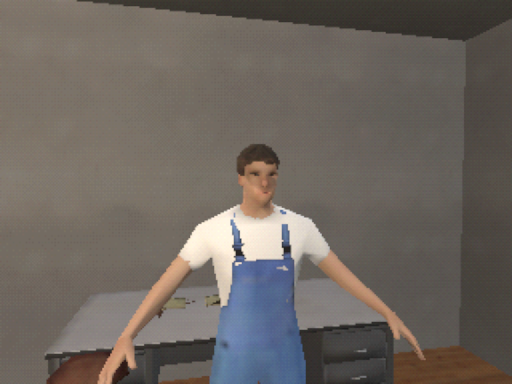
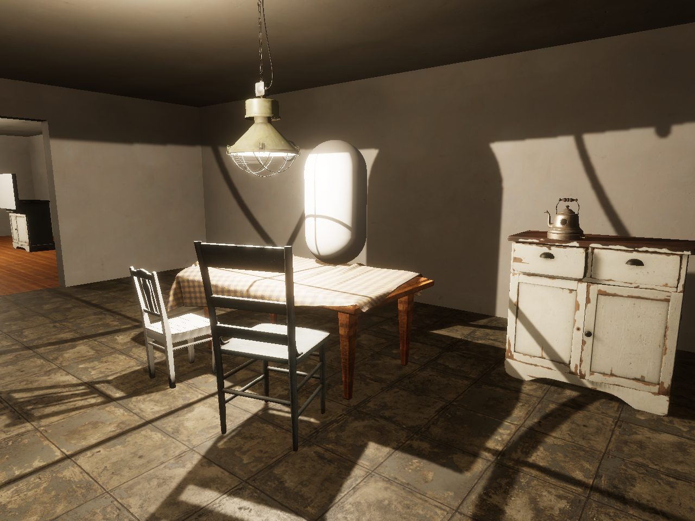
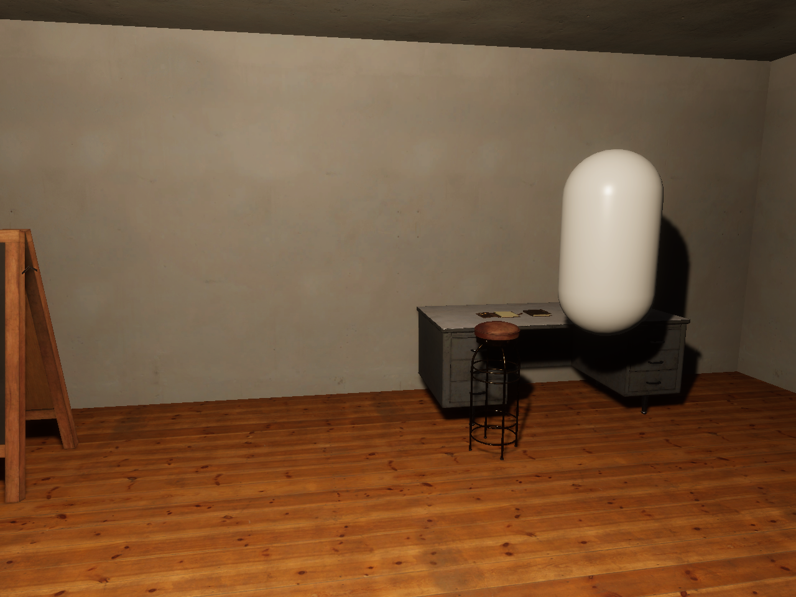
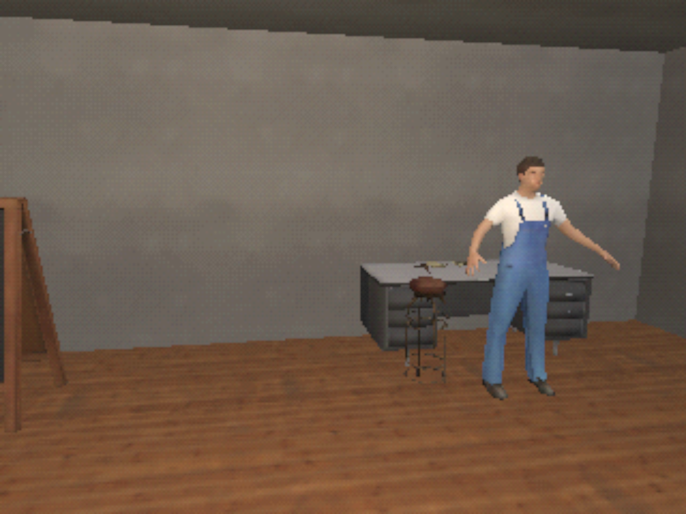
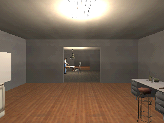
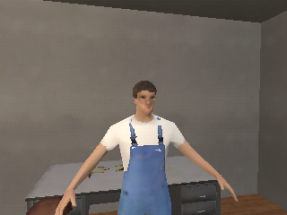
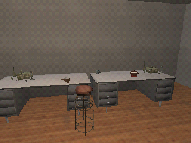
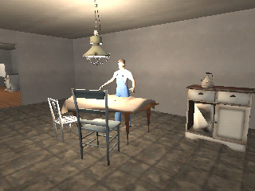
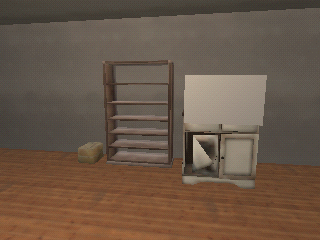
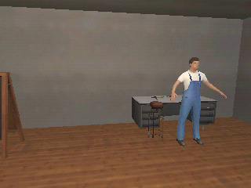

# N64 / GoldenEye 007 aesthetic experiment

Issue #67, on the branch `experiment/n64-goldeneye`. The owner asked on 2026-09-28 to pause the
realism work and experiment with other aesthetics, starting with the N64 and specifically
GoldenEye 007. Nothing here changes `main` or the playable scene. It proposes a look and does
not approve one.

## What the experiment does

`python3 scripts/build_n64.py` builds `Assets/CommonHouse/Experiments/N64/OutpostN64.unity` from
the furnished outpost. `OutpostBlockout.unity` itself is not changed.

| GoldenEye trait | How it is approximated |
|---|---|
| 320×240 frame, softened by the console's video output | The camera renders at 320×240, and the review copy is scaled up with bilinear filtering. |
| 16-bit (5-5-5) framebuffer with dithering | The custom HDRP post-process `N64Screen` reduces each channel to 5 bits with a 4×4 ordered dither. |
| Small, blurry textures | Every texture is area-averaged to 64 px and filtered bilinearly, with no normal, roughness, or occlusion maps. Wall and floor textures repeat every 1.6 m. |
| Low-poly models | Blender decimates each prop to roughly 40–900 triangles (`tools/experiments/n64_targets.json`). The test resident drops from 40,330 to 1,191 triangles with its skeleton kept. |
| Baked, even lighting and no shadows | Shadows are off, lamps run at 35% against a brighter flat ambient, there is no tonemapping, and there is no AO or bloom. |
| Distance fog | HDRP fog with a 14 m mean free path. It barely shows in rooms this small. |

The decimated test resident stands where the two resident capsules are. It is the pipeline test
character from issue #65, not a resident design. The capsules keep their colliders and dialogue
targets.

### Pasted faces

GoldenEye put photographs of the developers onto simple heads. Here, `FacePhotos` photographs
the detailed resident head-on in even light. It crops the photo to an oval and shrinks it to
64×80 px, then projects it onto each low-poly resident's face with an HDRP decal attached to the
head bone, so it follows the head. The photo is a render of our own generated character, not of
a real person. Using real faces, as Rare did, would need each person's consent and a recorded
decision.

`python3 scripts/capture_n64.py` renders six views from both scenes: the realistic one at
1280×960, and the N64 one at 320×240 plus a scaled-up copy.

## Comparison

Kitchen, realistic and N64 (scaled up):

Workshop, realistic and N64 (scaled up):

Native 320×240 frames, as the renderer produced them:

  
 

## How it differs from GoldenEye

- Lighting is still per pixel. GoldenEye baked light into vertex colours, so its surfaces show
  soft vertex gradients rather than hotspots. Matching that needs a custom vertex-lit shader.
- Textures are shrunken scans, not hand-painted. GoldenEye textures were small paintings and
  photographs with strong patterns. Walls here read as flat grey.
- The face photo sits on MPFB's modelled face, which is far more detailed than a GoldenEye head.
- Decimation leaves some artefacts, such as the cabinet door's diagonal triangle. Two models are
  not decimated: the chalkboard lost its board, and the pendant lamp fell apart.
- The playable build and first-person camera still render at full resolution. The N64 look only
  appears in the review capture. Playing it would need the camera to render to a 320×240 target.
- Frame rate was not limited. GoldenEye often ran well below 30 frames per second.

## Verification

On Kvant, 2026-09-28, from an uncommitted tree based on `0a5b674`:
`capture_n64.py` passed and all views were inspected
(`n64-20260928T183058Z-xfqqt07f`). EditMode (94) and PlayMode (89) passed. `check_provenance.py`
reported 205 entries. Every generated texture and model has a `generated` entry naming its source.
