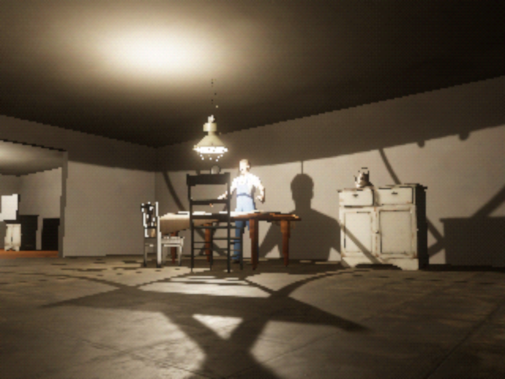
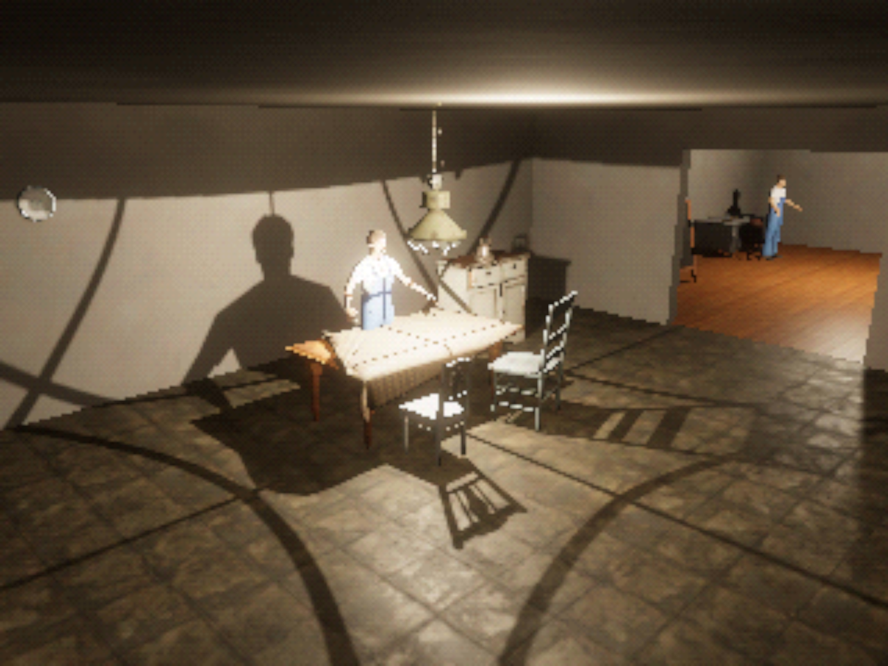
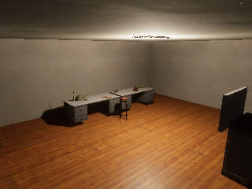
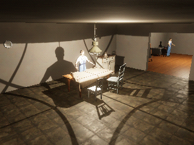
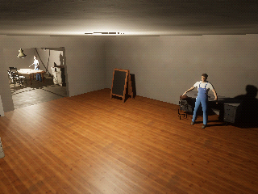
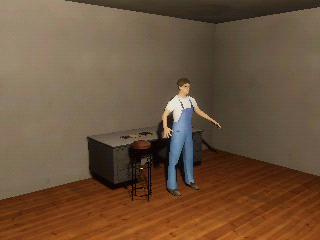

# Pre-rendered background experiment

Issue #71, on the branch `experiment/prerendered`, stacked on the
[PS1 experiment](ps1.md). It proposes a look and does not approve one.

Final Fantasy VII to IX, and Resident Evil, showed detailed pre-rendered rooms from fixed,
composed camera angles, with low-poly characters moving through them. This experiment keeps the
realistic HDRP outpost, lighting, and shadows, and places the N64 experiment's low-poly resident
(with its face photo) at the two resident positions. It renders five fixed shots at 320×240,
dithered to 15-bit colour and scaled up with bilinear filtering.

```sh
python3 scripts/style_experiment.py build prerendered
python3 scripts/style_experiment.py capture prerendered
```

## Shots





Native frames:

 
 


## What it would mean for the game

- Fixed cameras change play. The player would move through rooms seen from set angles, with
  "tank" or camera-relative controls, instead of looking around in first person. That suits
  suspense: what the camera does not show can carry unease, and composed shots support the brief's
  emphasis on familiar rooms changing.
- The backgrounds do not have to be pre-rendered. Real-time HDRP rendering at a fixed angle gives
  the same look while keeping lighting changes, such as the lamp being off in "Radio desk, later".
- Low-poly residents against detailed rooms is a deliberate contrast. It lowers the cost of
  character art, which is the project's hardest asset problem.

## Known limits

- Shots were placed by hand around the current blockout, not designed for scenes.
- Residents stand in MPFB's A-pose, and one faces away from some shots.
- The look exists only in the review capture, not in play. No camera switching or controls exist.
