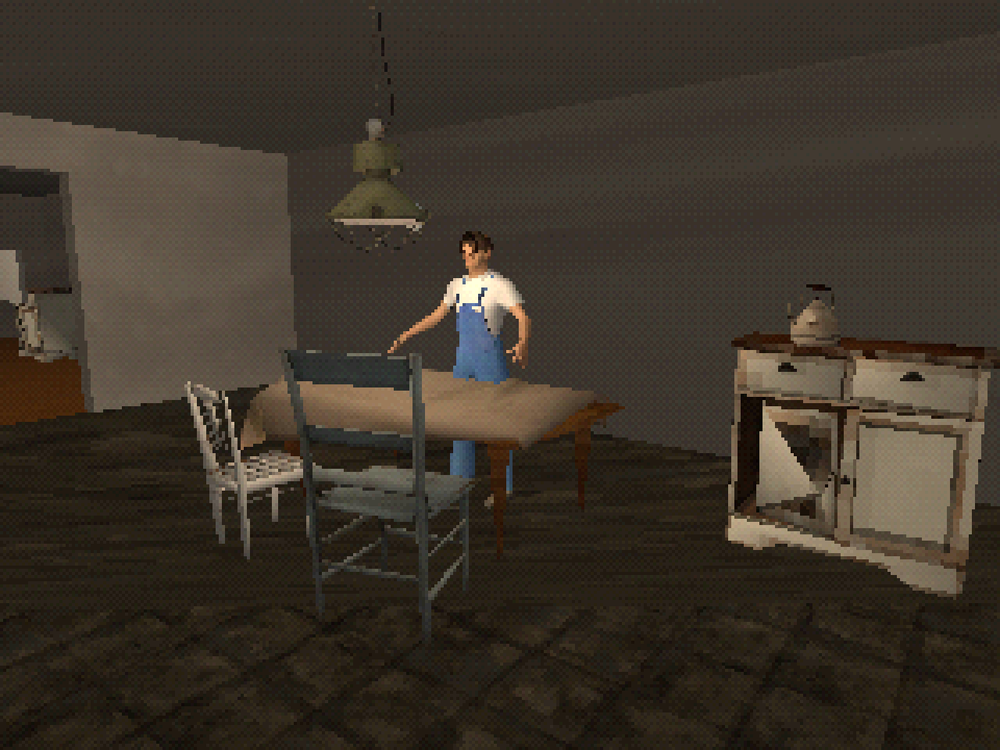
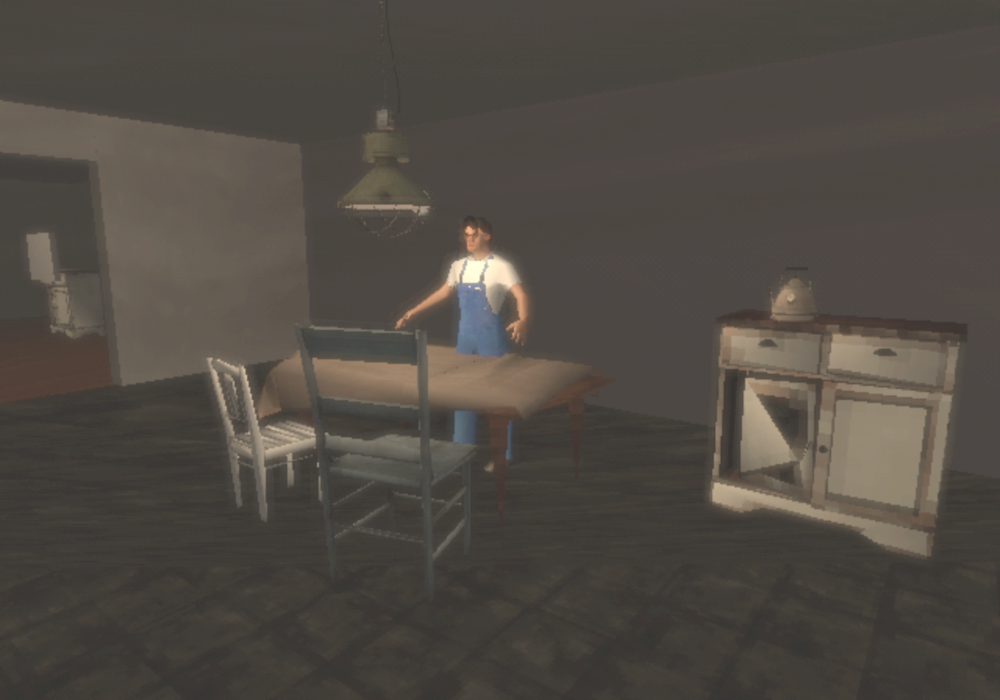
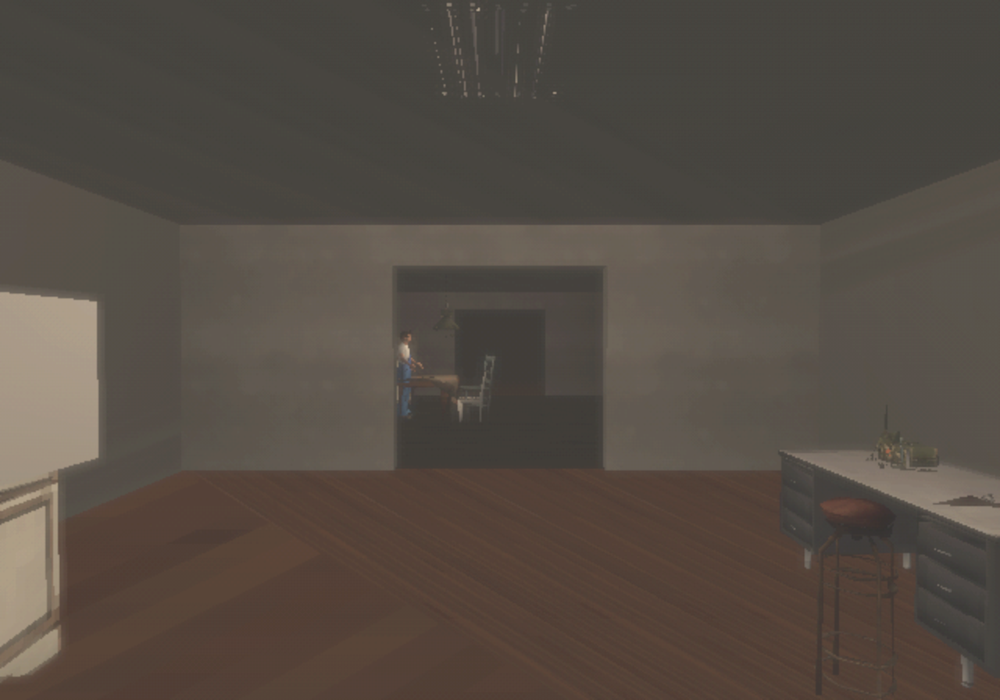
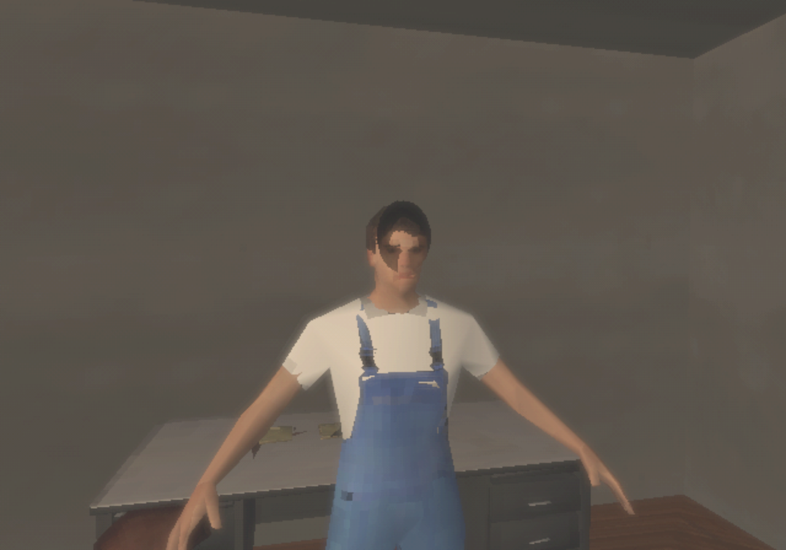
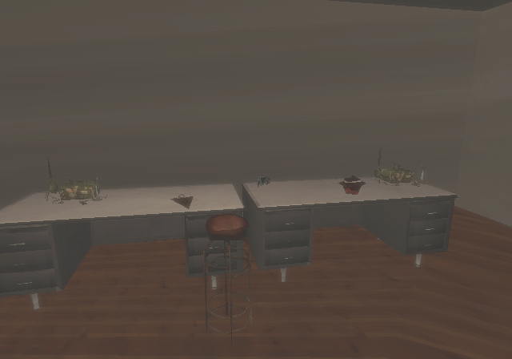
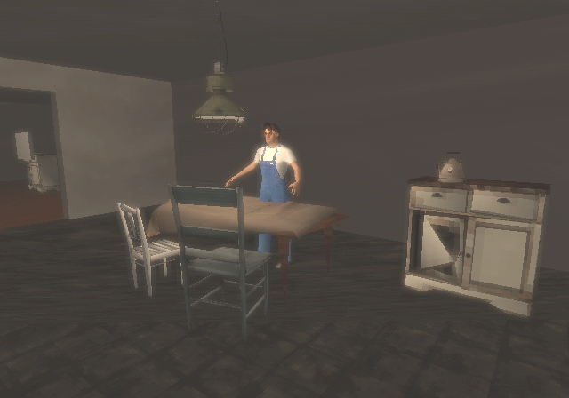
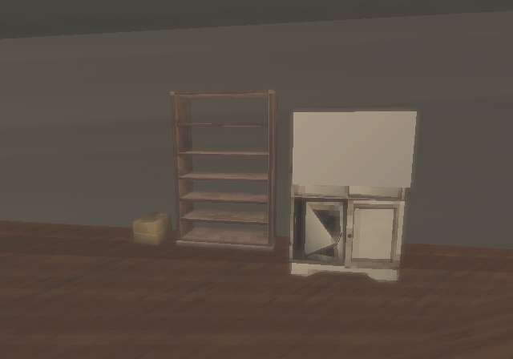
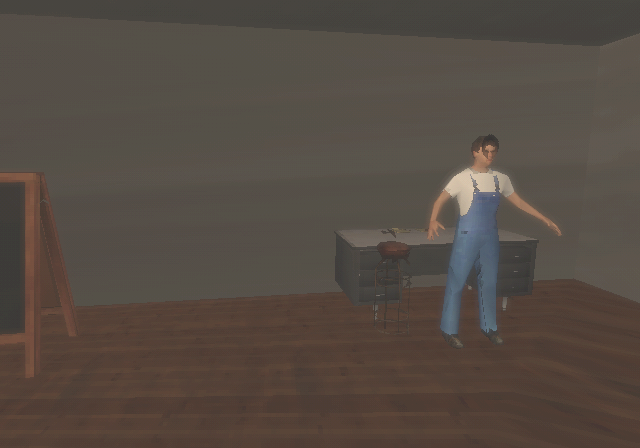

# PS1 look with a GTA 3-style PS2 treatment

Issue #77, on the branch `experiment/ps1-gta3`, stacked on the [PS1 experiment](ps1.md). This is
the direction the owner chose ([D-24](../design/decisions-and-open-questions.md)): models and
graphics in the family of late-1990s and early-2000s console 3D. The owner's references are
GTA 3, Silent Hill, GoldenEye 007, Mission: Impossible 64, Resident Evil, Mizzurna Falls, and
System Shock. It is about models and graphics only, not gameplay, camera, or tone. The first-person
camera stays.

## What changes from the PS1 experiment

`python3 scripts/style_experiment.py build gta3` builds
`Assets/CommonHouse/Experiments/Gta3/OutpostGta3.unity` from the PS1 scene:

| Trait | Setting |
|---|---|
| Frame size | 640×448, the NTSC PS2 frame GTA 3 used, instead of 320×240. Vertex snapping uses the same grid, so jitter is finer. |
| Haze filter | A new post-process, `HazeFilter`. It blends each pixel towards a soft blur where the blur is brighter, so bright areas glow. Then it tints the image warm, lifts the blacks, and lowers saturation slightly. |
| Fog | Heavier and brownish grey, from 5 m to 22 m, calculated per vertex by the PS1 shader. |
| Dither | Lighter: 6 bits per channel at 60% strength, since the PS2 usually drew 32-bit colour. |
| Kept from PS1 | Affine texture mapping, unfiltered 64 px textures, vertex lighting, low-poly models, and face cards. |

Scaling up for review uses bilinear filtering, like the PS2's soft video output.

## Comparison

Kitchen, PS1 and then with the GTA 3-style treatment:

Native 640×448 frames:

  
  

## Where the references show

| Reference | Trait used here |
|---|---|
| GTA 3 | Soft 640×448 frame, glowing haze, washed blacks |
| Silent Hill | Distance fog, dark vertex-lit rooms |
| GoldenEye 007, Mission: Impossible 64 | Photo faces on low-poly heads |
| Resident Evil, Mizzurna Falls | Unfiltered, warping textures on chunky models |
| System Shock | Not yet used; its dense, grimy interiors point to prop density and texture work |

## Next steps towards a playable look

- Render the first-person camera at 640×448 in play, not only in review captures.
- Replace shrunken scans with purpose-made 64–128 px textures. Many references used strongly
  patterned, hand-made or photo-sourced textures, which read better at this size.
- Give the residents simpler heads with the face photos mapped on, instead of cards over detailed
  faces. Add idle animation.
- GTA 3's "trails" blended in earlier frames. This needs frame history and is not implemented.

## Verification

On Kvant, 2026-09-28: the build and capture passed, and all views were inspected
(`gta3-20260928T213616Z-fw2nn20x`). EditMode (94) and PlayMode (89) passed on this branch.
