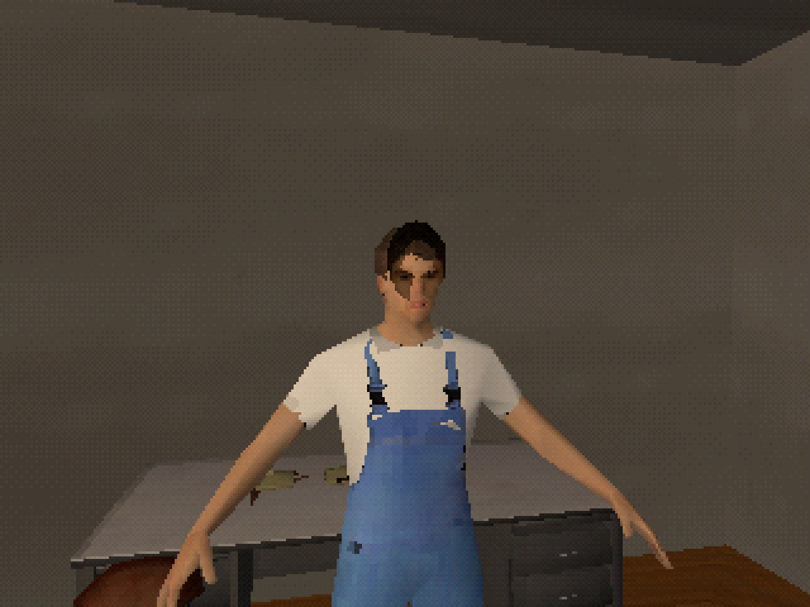
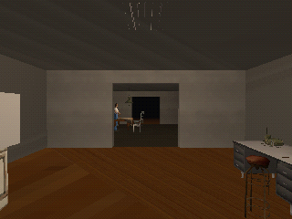
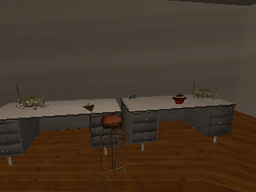
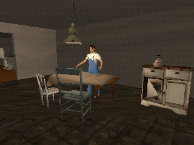
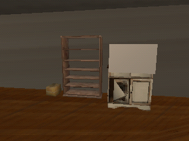
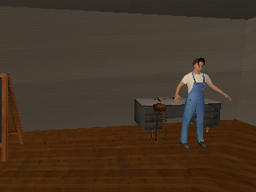

# PS1 aesthetic experiment

Issue #69, on the branch `experiment/ps1`, which starts from the
[N64 / GoldenEye experiment](n64-goldeneye.md). The owner asked on 2026-09-28 to see a
PlayStation version. Nothing here changes `main` or the playable scene. It proposes a look and
does not approve one.

## What the experiment does

`python3 scripts/build_ps1.py` builds `Assets/CommonHouse/Experiments/PS1/OutpostPS1.unity`
from the N64 scene. It reuses that scene's decimated models and 64 px textures, so run
`scripts/build_n64.py` first when those change. Every surface uses a new HDRP shader,
`CommonHouse/PS1`, which HDRP draws as an unlit pass:

| PlayStation trait | How it is reproduced |
|---|---|
| Affine texture mapping | Texture coordinates are interpolated in screen space without perspective correction, so textures bend across large triangles. The blockout's two-triangle walls and ceilings show a visible seam. |
| Vertex jitter | Vertex positions snap to a 320×240 screen grid. It shows when the camera moves, and hardly at all in stills. |
| No texture filtering | Textures are point-sampled, so their 64 px texels stay square. |
| Gouraud lighting and vertex fog | `PS1Lighting` passes the scene's point lights, an ambient colour, and fog distances to the shader, which lights and fogs each vertex. |
| 15-bit colour with dithering | The N64 experiment's `N64Screen` post-process, at 5 bits per channel with ordered dither. |
| Sharp 320×240 output | Frames render at 320×240 and are scaled up without filtering. |

HDRP decals cannot project onto a custom unlit shader, so each resident's pasted face photo
becomes a flat card on the head bone, as several PlayStation games drew faces.

`python3 scripts/capture_ps1.py` renders the same six views as the N64 comparison.

## Images

Native 320×240 frames:

  
  

## Known limits

- The face card is a flat quad lit like any other surface. From the side it shows as a card,
  and a single lamp can shade it unevenly.
- The PlayStation had no depth buffer, so its polygons sometimes sorted wrongly. That is not
  reproduced.
- Textures are the N64 experiment's shrunken scans, not hand-drawn, palette-limited textures.
- Glass and other blended surfaces are cut out rather than blended.
- As with the N64 experiment, the look exists only in the review capture, not in play.

## Verification

On Kvant, 2026-09-28: `build_ps1.py` and `capture_ps1.py` passed, and all views were inspected
(`ps1-20260928T183901Z-3ousc8j9`). EditMode (94) and PlayMode (89) passed on this branch.
