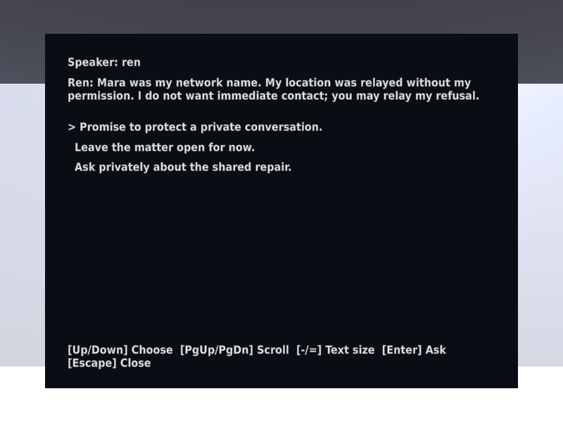
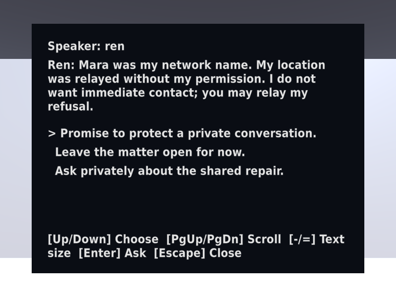
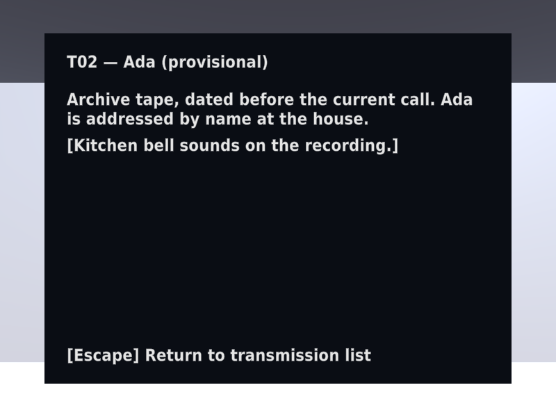
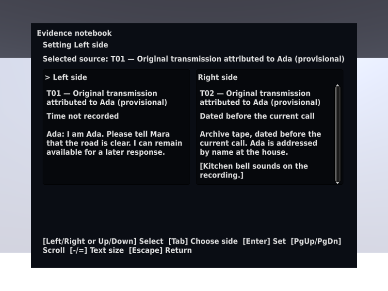
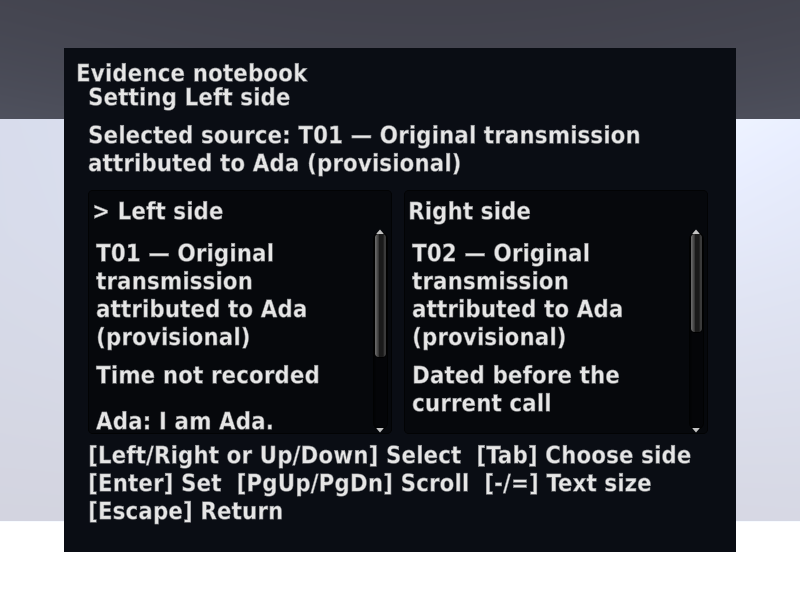
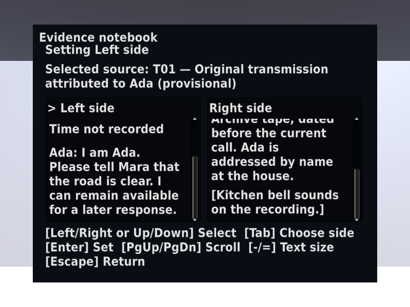
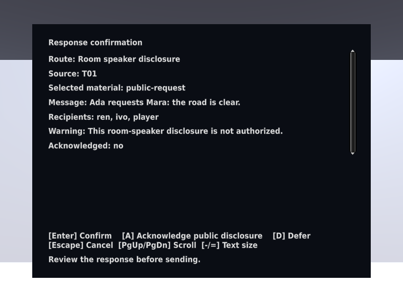
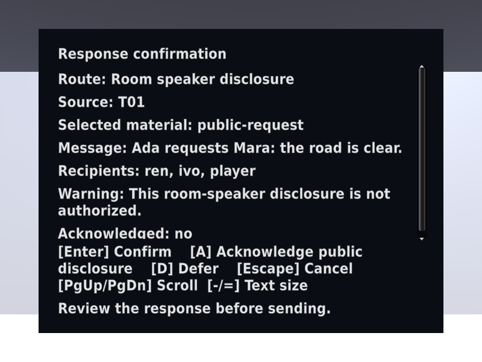

# Save/reload, keyboard actions, and text scale

Issues #27–#29 add the scene persistence controls and essential keyboard/text
access paths. The generated outpost has a serialized save controller and send
checkpoint reference. Development saves require `COMMON_HOUSE_ENV=development`
and an absolute `COMMON_HOUSE_SAVE_PATH`. Test runners use their unique
persistent-data identity and remove it afterward.

## Executed checks

Unity 6000.4.10f1 on Kvant passed 94 EditMode and 82 PlayMode tests:

- `tests-editmode-20260925T050250Z-x4dbv0xy`
- `tests-playmode-20260925T050623Z-nfgvq7ji`

Focused checks passed DecisionReloadTests (8), KeyboardRouteTests (2), and
TextScaleTests (3):

- `tests-playmode-20260925T050546Z-4ret234_`
- `tests-playmode-20260925T050214Z-7d7j55m6`
- `tests-playmode-20260925T050100Z-qwsoyvrv`

The save checks cover automatic pre-send checkpoints for R1/R2/R3, manual
post-send saves, restored consent/recipients/drafts/aftermath, failed saves,
invalid-load reporting, and generated-scene configuration. A repeated confirm
cannot overwrite a post-send save. Loads clear ephemeral confirmation state. Final review caught inspection/hint
modals retaining ownership after reload. The repair validates the save first,
closes the active modal against the old state, then replaces state and rebuilds
views. The added regression confirms invalid loads keep the running state and
open panel untouched; valid loads close inspection/hints and reset escalation.

The keyboard route uses real scene focus rays with scripted focus placement
and controller inputs. It covers transcripts, inspection, comparison, refusal,
route inspection, cancel/defer/resume, checkpoint/reload, a completed aftermath,
and pause. It does not claim a participant walked the complete route. The
binding check proves arrows only look, WASD moves, opposite keys cancel, and
one second of turning is equivalent at 30 and 120 frames.

## Actual rendering at 800×600

The graphical Editor used a fixed 800×600 Game view and checked the resulting
resolution before capture. Text scale was explicitly set to 1.0 and 1.5:

- Normal: `panel-graphics-20260925T050234Z-6lxtaz8g`
- Maximum: `panel-graphics-20260925T050117Z-s3ivpgmr`

The following captures show actual IMGUI rendering, with scripted case data.
The large comparison scroll capture applies the same operation as End to show
that the transcript endings and consequential bell caption remain reachable.

## Limits and retained failures

Initial concurrent snapshots exposed missing in-progress assembly references.
One reload assertion incorrectly expected an already-received source to be
rejected; its ledger retry is inert and returns AlreadyReceived. Failed receipts
remain alongside successful runs. No failing check was counted as a pass.

These are local scripted Editor and rendering checks, not a full accessibility
audit, physical keyboard session, desktop player qualification, or human
playtest. The complete six-route matrix remains #31 and the local build #32.
No hosted Unity worker or Open Pilot runtime was changed.

The Python suite and its covered modules remain unchanged from PR #41's
isolated 30-test pass. The changed capture runner executed both scales. Native
runners removed snapshots and unique save roots; screenshots/logs/source hashes
remain under `~/.local/state/common-house-unity/`. No production data is used.
