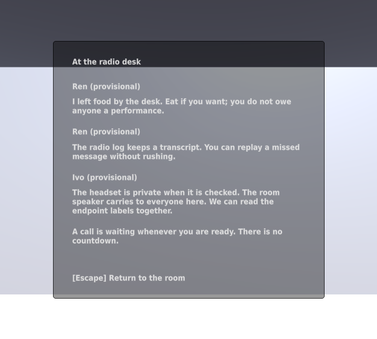
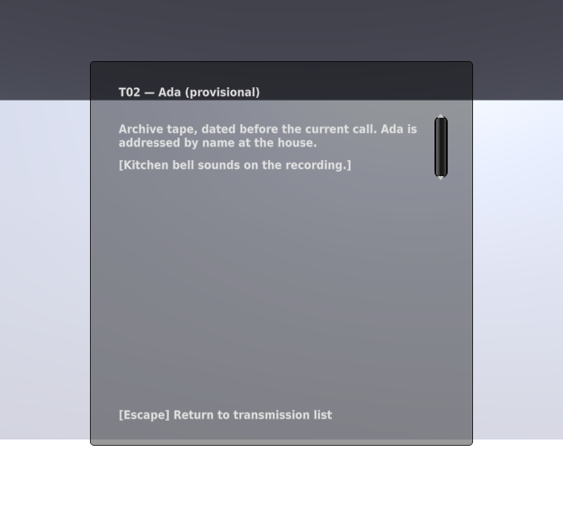
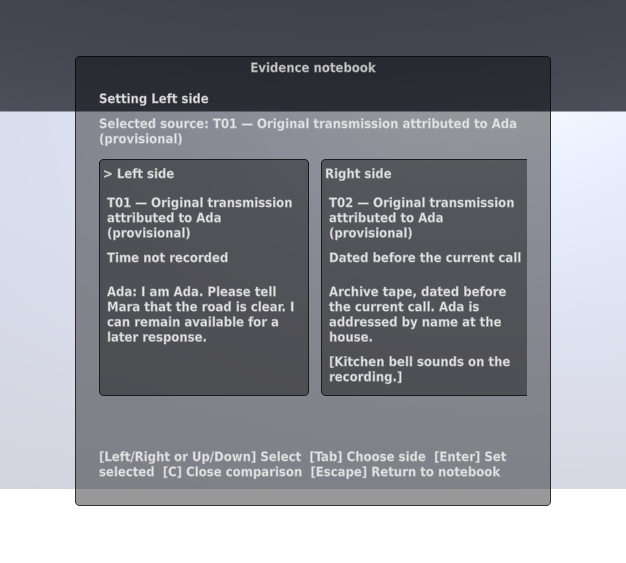
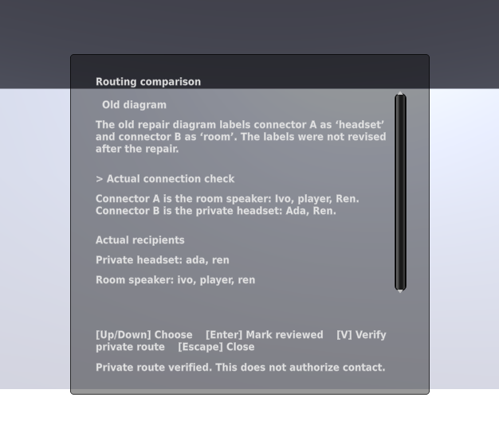

# Opening, comparison, archive, and route verification

Issues #15, #17, #18, and #23 add the household opening, explicit first-call
receipt, acquired-source comparison, the archive tape, and private-route
inspection. Scene targets use the same camera ray, range, and occlusion check
as generic inspection. There is no global shortcut for receiving a call or
verifying a route.

## Executed checks

On Kvant with Unity 6000.4.10f1, 89 EditMode tests and 41 PlayMode tests passed:

- `tests-editmode-20260925T042138Z-sr4c5bpg`
- `tests-playmode-20260925T042315Z-1j0z_q8d`

Focused results: 4 comparison tests, 5 opening tests, 1 archive-tape scene test,
and 5 route-inspection tests. The final comparison-label presentation edit
also passed its four focused tests (`tests-playmode-20260925T042327Z-ahqmsl_h`).

The scene tests use actual generated targets and the shared focus/activation
path. They establish transcript/caption availability, safe cancellation,
repeat-safe acquisition, readable recipient records, and route verification
without consent. Comparison preserves attribution and explicitly displays
unknown times. No calendar date was invented for the archive tape.

Early verification caught a stale test property name, a missing world-focus
prompt, and a test that dismissed the welcome before its Start callback. The
corrected tests wait for scene initialization and then dismiss the welcome.
Failure receipts remain private; the failing attempts are not passes.

## Graphical inspection

`panel-graphics-20260925T042350Z-jij98gt2` captures the real Game view with IMGUI.
The four panels below were inspected after scripted opening/selection. The
capture uses disposable seeded state, not observations from a participant.

## Limits and cleanup

The remaining evidence conversations, send confirmation, and aftermath are
not yet wired. Keyboard scrolling and scalable text remain later tasks.
Opening presentation flags and reviewed diagram pages are scene-local; reload
integration must close stale panels and preserve the separate domain facts.

Runners removed temporary project and save directories. Logs and receipts
remain under `~/.local/state/common-house-unity/`. No desktop build, hosted
Unity runner, full case route, or human playtest is claimed by this batch.
