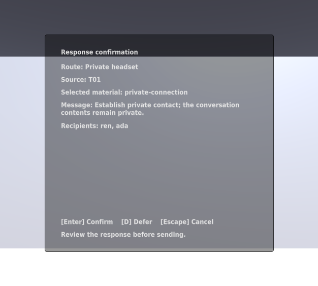
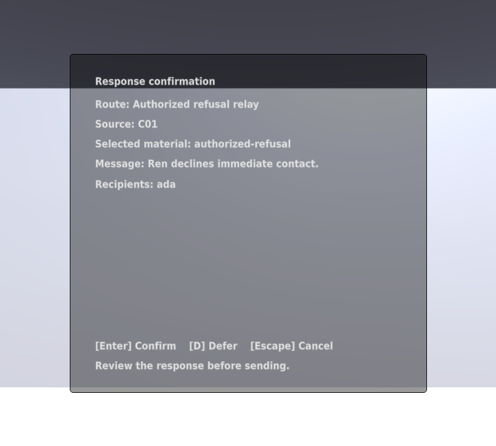
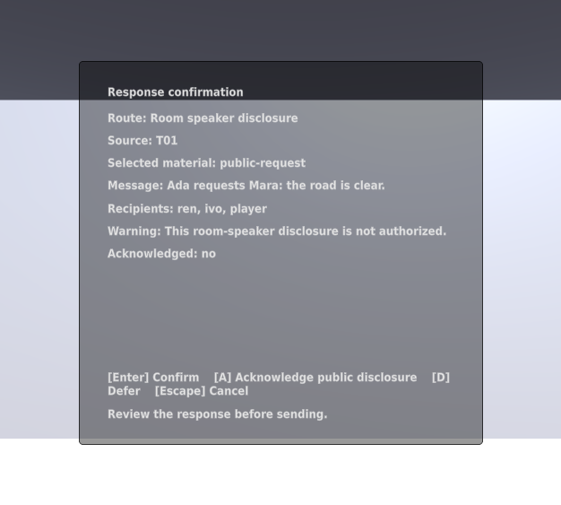
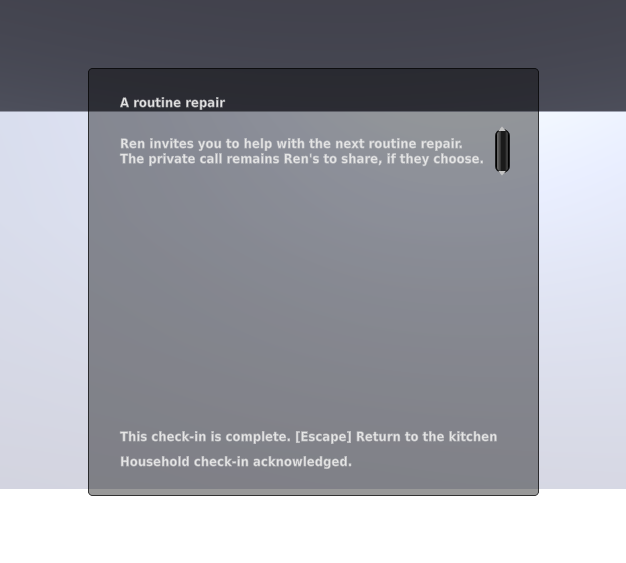
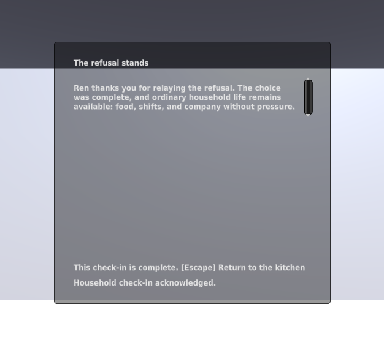
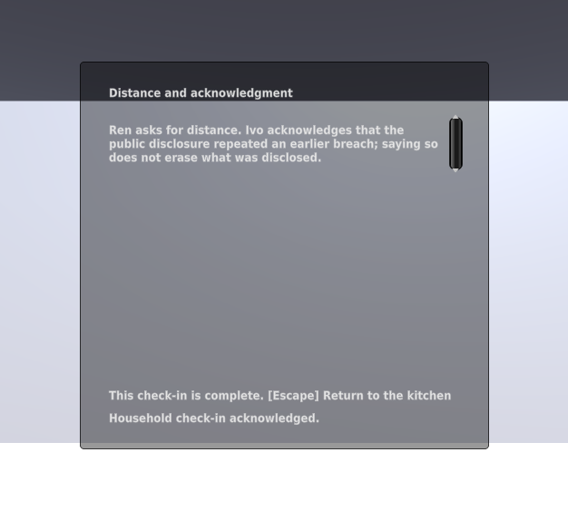
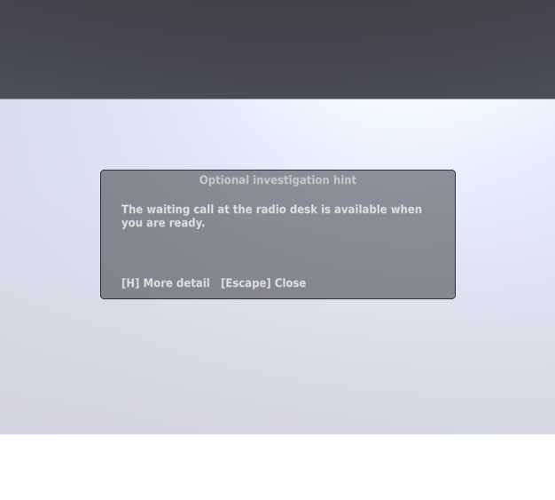

# Case resolution verification

Issues #24, #25, and #30 add explicit response review, the matching household
check-in, and optional escalating hints to the generated outpost.

## Native checks

Unity 6000.4.10f1 on Kvant passed 94 EditMode and 67 PlayMode tests:

- `tests-editmode-20260925T044545Z-4o2ltejv`
- `tests-playmode-20260925T044544Z-1p_fjot9`

Final focused checks additionally passed SendConfirmationTests (7),
HintTests (5), and HintPresentationTests (2):

- `tests-playmode-20260925T044647Z-30h8f2i6`
- `tests-editmode-20260925T044604Z-9488xh03`
- `tests-playmode-20260925T044550Z-08tye3h7`

The final send check rejects simultaneous acknowledgment and confirmation.
Deferral before choosing a route remains resumable. Hints reset their level
when recorded state changes and do not suggest refusal after private contact
has been explicitly authorized. Aftermath checks cover all three outcomes,
repeat acknowledgment, no early opening, and the generated kitchen target.

## Rendered panels

The actual Game view was captured with scripted isolated state in
`panel-graphics-20260925T044947Z-1kbtqxgb`. The 626×563 capture shows the exact
message, source, recipients, and separate public-disclosure acknowledgment.
All three aftermath variants and the initial optional hint were inspected.

## Limits and cleanup

These are scripted Editor checks, not a human playtest or desktop build.
The current small-window panels still need the shared text-scale and keyboard
scroll work in #28–#29. Runtime save/load remains #27. Complete route
qualification remains #31. Names and story wording remain provisional.

The Python regression suite and covered modules are unchanged from PR #41's
successful isolated 30-test run. The updated capture tool ran against the
actual graphical Editor. Documentation links were checked after this report.
Native runners removed their temporary projects and unique save directories;
logs, XML results, source receipts, and screenshots remain in private local
state under `~/.local/state/common-house-unity/`.
