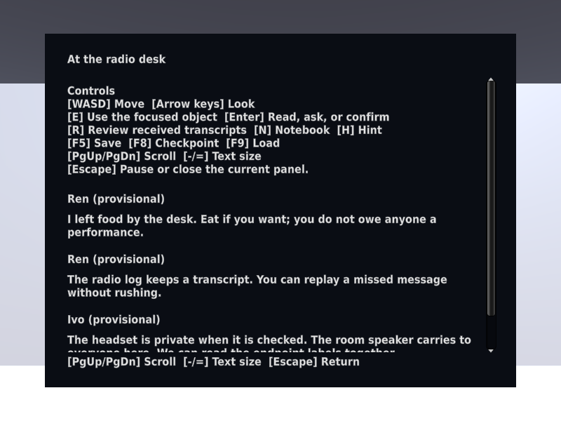
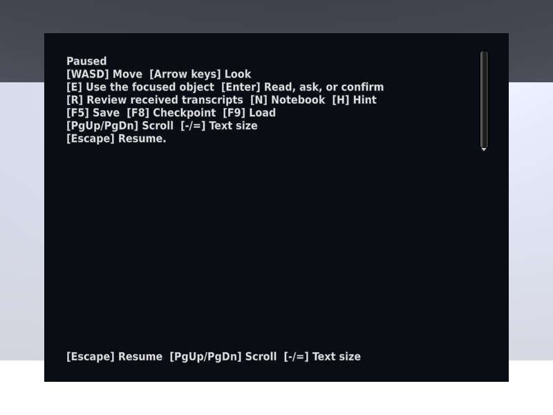
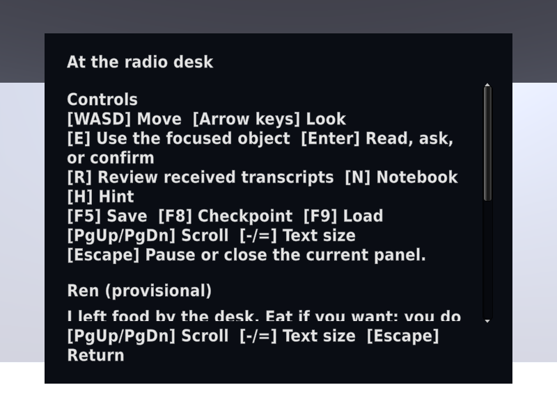
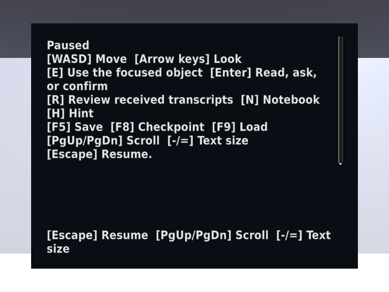
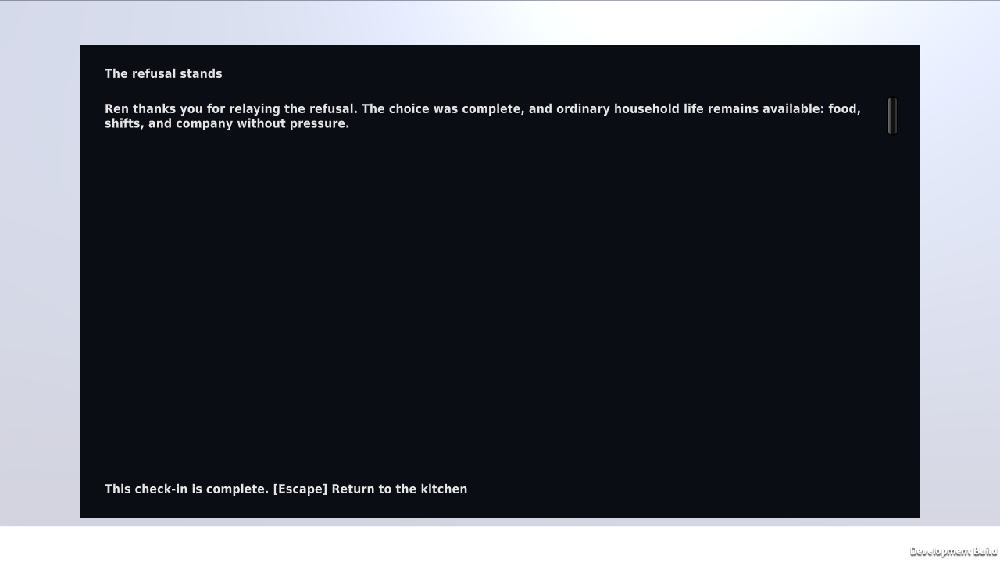

# Controls guidance verification

Issue #48 adds the existing controls to the welcome and plain Escape pause
screens. It does not change case facts, consent, outcomes, or bindings. The
owner's exploratory report identified a qualified clarity concern; source
inspection established the missing control reference. This change does not
establish or resolve a narrative-comprehension problem.

## Scene checks

On September 25, 2026, Unity 6000.4.10f1 passed the focused
`CommonHouse.Tests.ControlGuidanceTests` test (1/1) and the full
`CommonHouse.Tests` PlayMode suite (89/89). The new test loads the generated
outpost scene, checks welcome and pause guidance, modal Escape precedence,
resume, save-HUD suppression, and unchanged acquired sources, authorization,
and outcome. Existing feature tests cover the actions listed in the reference;
the new test does not independently replay every listed key.

Private evidence under `~/.local/state/common-house-unity/`:

- `tests-playmode-20260925T203959Z-6f650hy5` — focused pass.
- `tests-playmode-20260925T204210Z-rjtjxkfs` — full PlayMode pass.

The first focused compilation failed on a local variable name collision; the
corrected rerun passed. Failed evidence remains retained. Graphical capture
and the rebuilt desktop player are recorded separately below.

## Rendered guidance

Actual Game view captures passed at 800×600 at both supported scale endpoints:
`panel-graphics-20260925T204838Z-spdro27i` (100%) and
`panel-graphics-20260925T204931Z-a43bcv1z` (150%). Inspection confirmed wrapping,
scrollable welcome content, an explicit pause/resume instruction, and no
competing save HUD. Both copied projects and isolated save identities were
absent after cleanup.






The evidence tool now uses a utility Game view and reapplies its fixed size
after Play Mode reloads the Editor domain. Earlier docked-window size failures,
an Editor startup timeout, and the intermediate null reflection-type failure
remain in private `panel-graphics-*` receipts and logs. The final captures
retain strict resolution and required-artifact checks; no image resizing or
relaxed check produced these passes. These are scripted rendered checks, not
human keyboard or comprehension evidence.

## Rebuilt Linux player

The local Linux Development Build and R2 player smoke passed from clean source
`87896434198200b545a5ba060a7adcecc9898f42`, using Unity 6000.4.10f1:

```sh
python3 scripts/build_poc.py --target local --smoke
```

Private evidence: `local-poc-build-20260925T205119Z-mj6dd1o4`.
The 249-file output manifest SHA-256 is
`f56f0a7a6de6cf735639608b4f05a2c13414978401e2e72255c2625f26947400`.
The 1280×720 player reached R2, restored the pre-send checkpoint, completed the
refusal and household aftermath, and saved/reloaded the completed state with
exactly one outgoing refusal disclosure. Source hashes match the committed
game files. The output manifest still matches after execution. The copied
project and unique persistent-data identity were absent after cleanup.



This is scripted player evidence, separate from the Editor images above and
from human observations. Your existing development save was not used or
changed. Run this retained build on Kvant with its own development save slot:

```sh
COMMON_HOUSE_ENV=development \
COMMON_HOUSE_SAVE_PATH="$HOME/.local/share/the-common-house/development/case01-8789643" \
"/home/onnwee/.local/state/common-house-unity/local-poc-build-20260925T205119Z-mj6dd1o4/test-data/player/TheCommonHouse.x86_64" \
  -screen-width 1280 -screen-height 720 -screen-fullscreen 0
```

The [owner exploratory report](../playtests/poc-evaluation.md) remains partial.
Issue #34 still needs player observations about understanding, recipients,
assistance, and restore behavior. No human evaluation threshold, story approval,
public release, or hosted Unity worker qualification follows from these checks.
