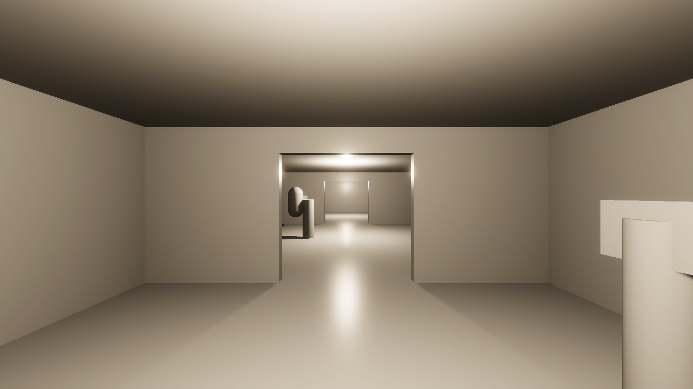
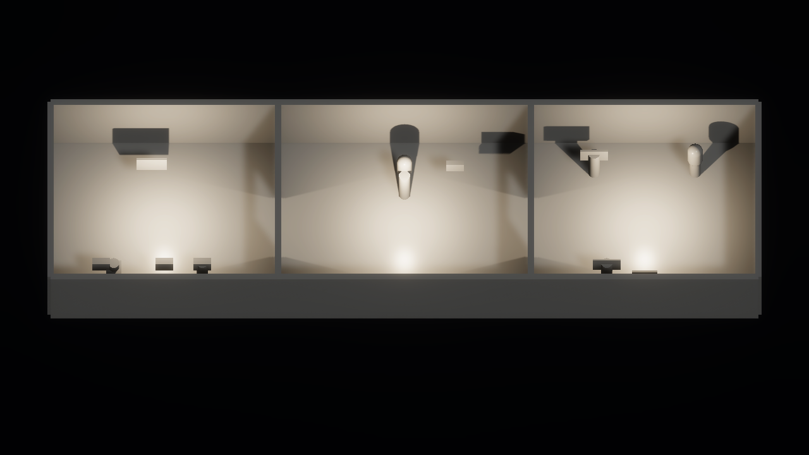

# HDRP migration verification

Decision [D-20](../design/decisions-and-open-questions.md) moves the project from the built-in
renderer to the High Definition Render Pipeline for higher visual realism. This report covers
the switch and the temporary blockout lighting. It does not cover final art, performance, or
any GPU other than Kvant's.

## What changed

- `Packages/manifest.json` adds `com.unity.render-pipelines.high-definition` 17.4.0, supplied
  by the installed Editor.
- `CommonHouse.Editor.RenderPipelineSetup.ConfigureHdrp` creates
  `Assets/CommonHouse/Rendering/HDRenderPipelineAsset.asset` and makes it the default pipeline.
  It clears the per-quality-level pipeline overrides, sets linear colour space, and limits
  Linux players to Vulkan. HDRP generated `Assets/HDRPDefaultResources/` and
  `ProjectSettings/ShaderGraphSettings.asset` on first import.
- `CommonHouse.Editor.OutpostVolume` adds a global volume to the generated outpost. It sets fixed
  exposure at EV100 4, turns off motion blur, and uses a dim gradient sky. The sky matters
  indoors because the blockout has no reflection probes, so surfaces reflect the sky.
- The outpost generator now uses physical light units. The temporary directional light is 20 lux,
  and each room has one 1500-lumen ceiling lamp. All lights cast soft shadows.
- `OutpostEvidence` and the style-board capture render each view twice, because HDRP applies
  exposure from the previous frame.
- The EditMode smoke test now asserts the HDRP asset, linear colour, and Vulkan-only Linux
  graphics APIs.

HDRP needs an `HDAdditionalLightData` component on every light. When a saved light lacks one,
HDRP adds it on load with its own defaults: a 100,000 lux sun and a dim point light. The
first HDRP captures were therefore completely white. The sun also cast no shadows and lit
the rooms through their ceilings. The generator now adds the component before setting units
and intensities.

## Regenerating settings and the scene

`scripts/run_editor_method.py` runs Editor methods in a disposable copy of the project and,
with `--copy-back`, replaces this checkout's `Assets/`, `Packages/`, and `ProjectSettings/`
with the result:

```sh
python3 scripts/run_editor_method.py CommonHouse.Editor.RenderPipelineSetup.ConfigureHdrp --copy-back
python3 scripts/run_editor_method.py CommonHouse.Editor.OutpostSceneGenerator.Generate --copy-back
```

Each method runs in its own Editor session with Vulkan forced. Review `git status` afterwards;
Unity also rewrites unrelated settings files and leaves trailing whitespace in YAML.

## Results

All results were produced on Kvant on 2026-09-26 UTC with Unity 6000.4.10f1 (AMD Radeon
RX 7900 XT, Vulkan, RADV NAVI31). The source was an uncommitted tree based on `6b91b4f`.
Evidence is under `~/.local/state/common-house-unity/`.

| Check | Command | Result | Evidence |
|---|---|---|---|
| EditMode tests | `run_unity_tests.py --platform editmode --filter CommonHouse` | 94 passed, `-nographics` | `tests-editmode-20260926T161914Z-k4mai67f` |
| PlayMode tests | `run_unity_tests.py --platform playmode --filter CommonHouse` | 89 passed, `-nographics` | `tests-playmode-20260926T162007Z-3510g8p3` |
| Outpost render and traversal | `capture_outpost.py` | Passed; images inspected | `outpost-graphics-20260926T161748Z-qbha22dz` |
| Panel captures | `capture_panels.py` | Passed; consent panel inspected | `panel-graphics-20260926T162113Z-51jfyth7` |
| Linux build and R2 smoke | `build_poc.py --target local --smoke` | Passed | `local-poc-build-20260926T162257Z-2ahcjgs2` |

The tests run without a graphics device, so they check scene structure and logic, not
rendering. The build smoke player created a Vulkan swapchain at 1280×720. Its output has
294 files totalling 255,064,549 bytes; the built-in build in the
[local build report](local-build.md) had 249 files.





## Known limits

- The style board still uses the built-in Standard shader and a built-in surface shader for
  labels. Neither renders under HDRP: `capture_style_board.py` still exits 0, but every study
  image is a flat purple field (`style-board-20260926T162615Z-ry84hpfn`). The committed v0.1
  images remain built-in renders until the board is ported.
- The blockout uses HDRP's default grey material. Bloom and tonemapping come from HDRP's
  default volume profile and have not been tuned.
- There are no reflection probes, baked lighting, or light probes. Indirect light is limited
  to the gradient sky.
- Frame rate, memory, and load time were not measured. HDRP increases the player size and its
  GPU requirements; no minimum hardware target has been set.
- This is scripted evidence. It is not a human playtest.
