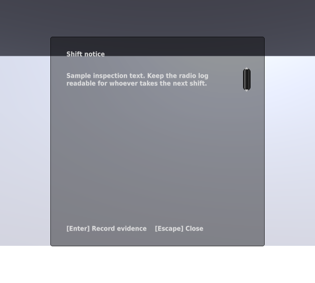
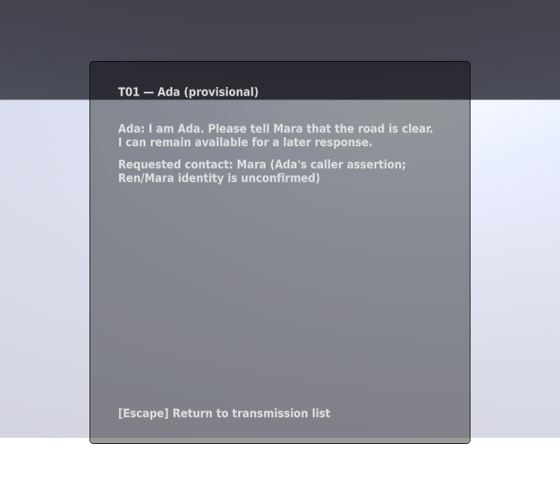
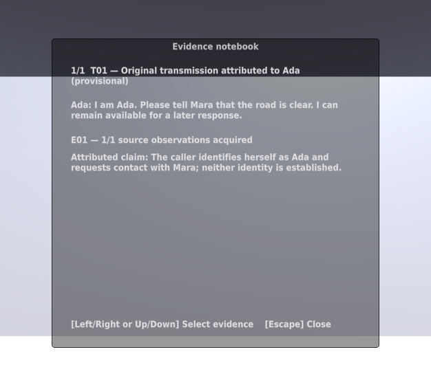
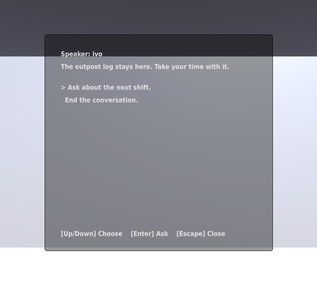

# Investigation reader verification

Issues #12, #13, #14, and #16 add shared modal input, object inspection,
transmission review, an acquired-source notebook, and dialogue presentation.
The generated outpost has an effect-free dialogue demonstration. The case
opening and resident-specific interactions remain separate tasks.

## Native checks

On Kvant, Unity 6000.4.10f1 passed 89 EditMode and 26 PlayMode tests against
the integrated source on 2026-09-25 UTC. Private receipts:

- `tests-editmode-20260925T041008Z-e5oa0dw7`
- `tests-playmode-20260925T041007Z-i4lz3bxz`

Focused checks passed: 4 InspectionTests, 3 TransmissionLogTests,
5 NotebookTests, 5 DialoguePresenterTests, and 1 ModalInputTests. A subsequent
speaker-label-only presentation edit passed the 5 dialogue tests
(`tests-playmode-20260925T041057Z-34ja7ivk`) and final native import
(`import-20260925T041110Z-scf_uwpi`).

The checks cover actual scene deserialization, range/occlusion, separate
inspection/acquisition, repeat-safe replay, acquired-only interpretations,
assertion versus identity confirmation, eligible questions, explicit effects,
and exclusive modal ownership. They use scripted input frames, not a human
keyboard session. Full keyboard scrolling and scalable text are later tasks.

Early compile failures exposed missing direct assembly references and a test
namespace import. Scene generation also exposed a null session during Editor
configuration and the loss of nonserialized dialogue defaults. These were
fixed; their private failure receipts remain available. None counts as a pass.

## Rendered panels

`python3 scripts/capture_panels.py` ran the actual graphical Editor and entered
PlayMode, then captured Game-view output including IMGUI. Receipt
`panel-graphics-20260925T041105Z-bj0qcsf8` contains the source hashes and GPU
identity. The images below were inspected: text and controls are visible,
source attribution is distinct from interpretation, and no consent is granted
by opening readers. The run explicitly seeded T01 inside disposable test
state; it does not prove the future household-opening interaction.

Window size depends on the local Editor layout. An earlier concurrent-Editor
capture produced a narrower view; the final capture ran alone with a maximized
Game-view pane. The panels remain temporary development presentation.

## Cleanup and limits

Native runners removed their temporary project and unique save directories.
Private logs and receipts remain under `~/.local/state/common-house-unity/`.
No license files were copied or changed. No hosted Unity CI, Open Pilot worker,
complete case route, desktop player build, or human playtest is claimed.

Reload replacement while a notebook is already open still needs explicit
reader refresh or closure in issue #27. The current scene has no reload UI.
