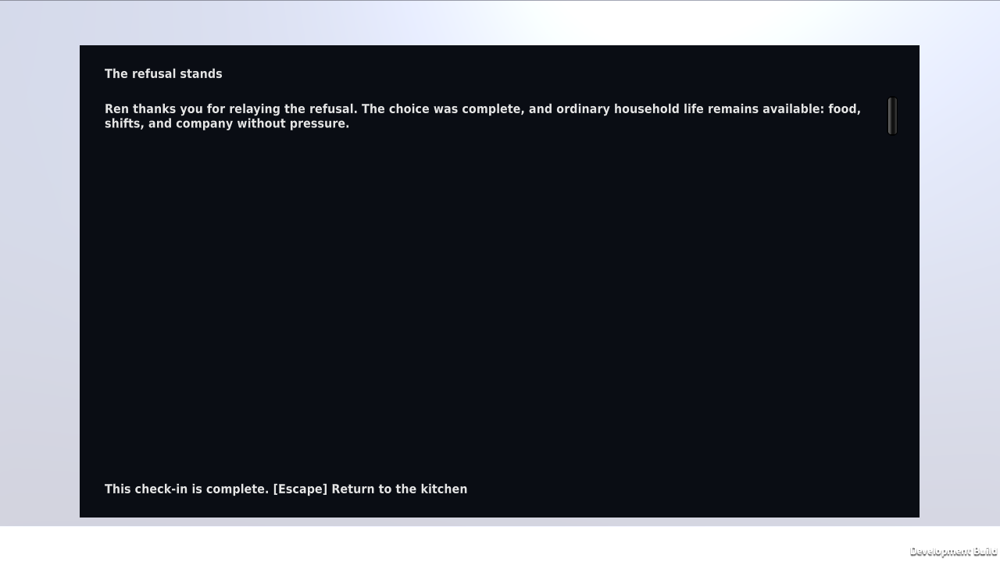

# Local Linux POC build verification

`python3 scripts/build_poc.py --target local --smoke` builds only the Case 01 outpost scene with the Editor pinned in `ProjectSettings/ProjectVersion.txt`, then launches that Linux player and performs the explicit R2 smoke route. The command requires the installed matching Linux standalone support and the normal local Unity licensing context. It never installs an Editor, build support, or license.

The runner copies only `Assets/`, `Packages/`, and `ProjectSettings/` into a disposable project. It rejects project symlinks, credential-like source files, and unreviewed local or Git package references. It gives that copy a unique `CommonHouseVerification/run-*` persistent-data identity, retains the normal host licensing context, and removes both the copied project and the unique save directory afterward. The build output, source receipt, sorted output hash manifest, player screenshot, structured smoke receipt, and private logs remain below `~/.local/state/common-house-unity/local-poc-build-*`.

The target is only Linux x86_64:

```sh
python3 scripts/build_poc.py --target local --smoke
```

Use `--editor /absolute/path/to/Unity` only for another installed Editor that exactly matches the pin. `--timeout SECONDS` bounds each Editor and player process. A timeout terminates the owned process group and fails the command.

The player smoke runs only when both `COMMON_HOUSE_ENV=test` and the exact command argument `--common-house-smoke=r2` are present. Normal development and production-style launches do not activate it. The smoke uses the generated scene's focus and interaction controllers to receive the call, speak privately with Ren, and prepare R2. It verifies the automatic pre-send checkpoint reloads to the unresolved R2 draft, sends again, completes the refusal aftermath, then performs a manual post-send save/load. It requires exactly one outgoing `radio-send:R2` disclosure, captures the player aftermath view, writes `smoke-result.json`, and exits.

The command fails for a missing/mismatched Editor, unavailable build support, license or compilation failure, absent/non-executable player output, malformed or missing receipt, output-hash failure, player crash or timeout, failed R2 state assertions, missing screenshot, or a leftover disposable save directory. It records the selected target, source revision and dirty state, input source hashes, full output manifest hash, Editor build receipt, player command, and disposable save path in its private `result.json`.

This is scripted local desktop-player evidence. It proves one local Linux build and scripted scene-controller route under disposable data. It does not prove a human playtest, input-device accessibility beyond the route checks, platform distribution readiness, performance, or Open Pilot worker support.

## Qualified local build

On 2026-09-25 UTC, the exact command above passed on Kvant using Unity
6000.4.10f1 and clean source commit
`55ed4c425565fa5f44d78f96c499664b7a5b1b4e`.

- Evidence: `local-poc-build-20260925T051721Z-xrevuj_r`
- Target: `StandaloneLinux64`, Development Build, actual player window 1280×720.
- Output manifest: 249 files, SHA-256
  `ab3a03a4bf858d492e2a3131889cb9eb48b016da5132ffd929ea61f6ba8e338e`.
- The output was re-hashed after the smoke; player execution did not change it.
- The actual runtime save path was inside the unique verification identity.
  The temporary project and that save identity were both absent after cleanup.
- Source hashes in the receipt match the retained runtime source. Later report
  edits do not change the built game.

The actual player reached R2 through scene targets and controller actions,
restored the unresolved pre-send draft, sent again, acknowledged the matching
household aftermath, then saved/reloaded the completed state. The final ledger
contained exactly one outgoing refusal disclosure. This was a scripted smoke,
not a participant session or physical keyboard route.



The first player attempt (`local-poc-build-20260925T051533Z-ckjmvnxi`) failed
because the generic Editor build list started with the empty Bootstrap scene.
Its executable, log, and failed receipt remain private. The POC builder now
explicitly selects `OutpostLayout.ScenePath`; the passing build above includes
that committed fix. Use the provided build command for this qualified entry.

## Run the retained player manually

The artifact remains on Kvant. This command selects a separate development
save root and leaves the automated smoke disabled:

```sh
COMMON_HOUSE_ENV=development \
COMMON_HOUSE_SAVE_PATH="$HOME/.local/share/the-common-house/development/case01-55ed4c4" \
"/home/onnwee/.local/state/common-house-unity/local-poc-build-20260925T051721Z-xrevuj_r/test-data/player/TheCommonHouse.x86_64" \
  -screen-width 1280 -screen-height 720 -screen-fullscreen 0
```

Use WASD to move, arrows or mouse to look, and E for the visible focused action.
Escape closes a panel or pauses; N opens the notebook, R the transmission log,
and H requests an optional hint. Panel controls are shown in the game. F5 saves,
F8 writes a checkpoint to the same slot, and F9 loads. `-`/`=` adjusts text size;
PageUp/PageDown/Home/End scroll text. Close the window to exit.

The environment and entry-point path were qualified by the automated run; the
manual launch command is provided for the owner's session. No participant
session has been conducted. Use a different development save root for each
participant if independent state is needed.

## Remaining owner input

Issue #34 requires actual consented, anonymized observations tied to this build.
The [observation sheet](../playtests/poc-observation-sheet.md) records conditions,
help given, route failures, recipient expectations, case understanding, and the
transcript-only condition. Preserve incomplete and failed sessions. The proposed
five-person thresholds are qualitative revision triggers, not audience claims.

No continuation recommendation or owner creative decision is inferred from
these automated checks. The POC remains a primitive blockout with provisional
names/story wording and no authored audio or final assets. This build is private;
no distribution license, public release, or hosted Unity worker was qualified.
