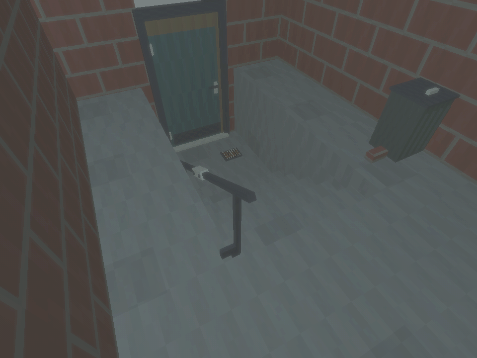
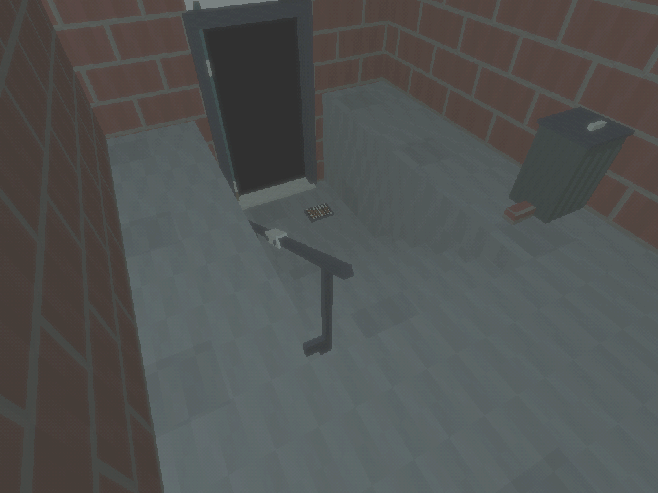
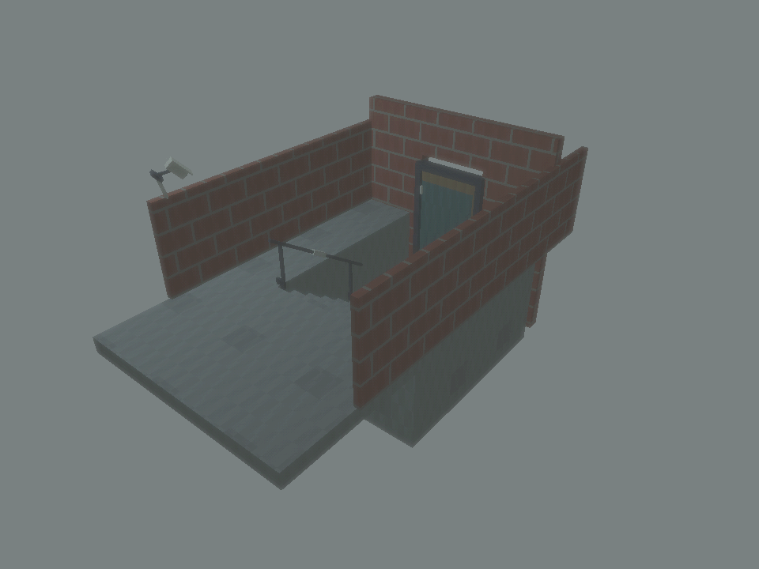
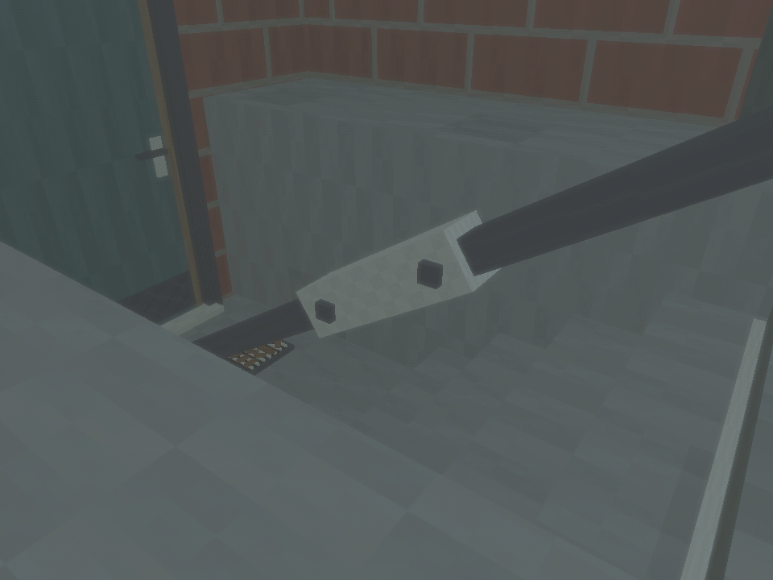

# Motion detected source asset verification

Date: 2026-09-30 local time. Scope: [issue #105](https://git.subcult.tv/PatrickFanella/the-common-house/issues/105). Source base: merged `main` at `fe81f8a`, with asset work on `t3code/motion-detected-source-set`. Retained receipt names use UTC and therefore begin with 20261001. [Asset guide](../development/motion-detected-source-assets.md) owns dimensions and camera coverage; the [episode contract](../design/episodes/motion-detected/case-contract.md) owns facts and inference limits.

## Delivered result

Six original reusable prefabs provide basement steps, closed and open doors, a repaired handrail, a leaf-filled drain, and a loose-lid bin. Nine original 64×64 textures and saved materials use the existing retro shader. The separate source review scene reuses the first kit's exterior camera. No new character, dialogue, audio, clip player, or playable memory is included.

The final source camera has a 4:3 frame and a fixed lens position matching the physical housing. The door is partly cropped at the top; the rail sleeve, drain, threshold, and edge-of-frame bin remain visible. The loose lid reaches the wall. Both door variants block views beyond the exterior threshold. Six stair collision heights match 0.20 m risers, and the landing remains at -1.20 m.

Initial rendered inspection prompted stronger riser contrast, quieter concrete grain, exterior lighting, and a detail viewpoint that shows the rail fasteners. The final scene uses the same source viewpoint for both door states. All six final images were inspected. The rail detail clearly shows its repair sleeve and two screw heads; it is an artist review view, not a substitute camera angle for the clips.

## Local evidence

| Check | Result | Receipt or command |
|---|---|---|
| Native final generation | Passed, six prefabs and nine textures | `~/.local/state/common-house-unity/motion-detected-assets-20261001T004154Z-yy5rjar1/` |
| Focused graphical EditMode fixture | 5 passed, 0 failed, 0 skipped; six rendered views | `~/.local/state/common-house-unity/tests-editmode-20261001T004628Z-bej2cput/` |
| Narrow-export regression tests in isolated T3 container | 5 passed, including the original kit's defaults and the second kit's separate allowlist/count | `python3 -m unittest discover -s tests -p test_build_season_assets.py` |
| Protected source comparison | 122 file hashes unchanged: existing SeasonOne kit files, 24 ProjectSettings files, intro and outpost scenes | Compared with the final generator's `source.json` |
| Provenance | 312 entries cover all sourced and LFS assets | `python3 scripts/check_provenance.py` |
| Binary sizes and LFS pointers | Passed | `python3 scripts/check_binary_sizes.py` |
| Document links and staged whitespace | Passed | `python3 scripts/check_docs.py`; `git diff --cached --check` |

The export copies only the new kit and its review scene. Owner Editor changes remain in the checkout and outside this commit. The final generator and native fixture removed their disposable projects; the fixture also removed its isolated save namespace. Logs, result XML, source hashes, and images remain in the receipt directories. No owner Editor restart was required.

## Source views

## Artist inspection

## Remaining production work

The source set remains provisional art. Jo, Min, and the son's camera appearance need character work. The three clips still need authored motion, overlap, rain and scraping audio, captions, transcripts, and source metadata. A later media reader must distinguish source availability from explicit acquisition and Jo's recognition. These static views do not establish an unlocked action, identity, return inference, later fate, episode runtime, player build, or human playtest result.
