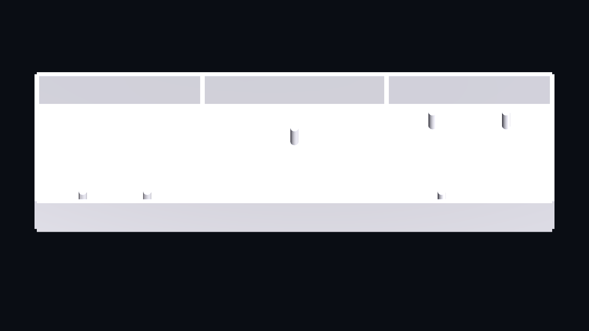
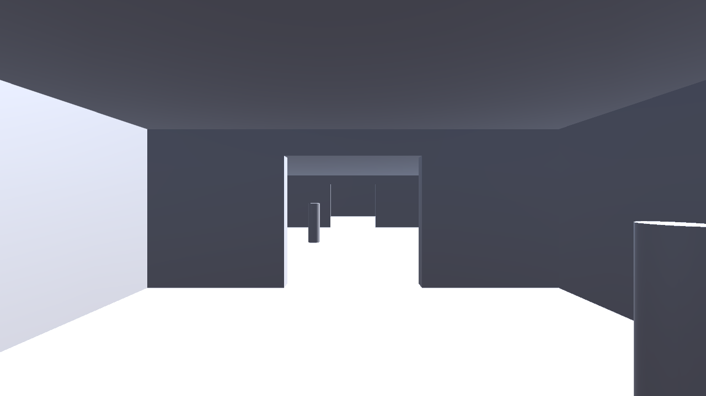
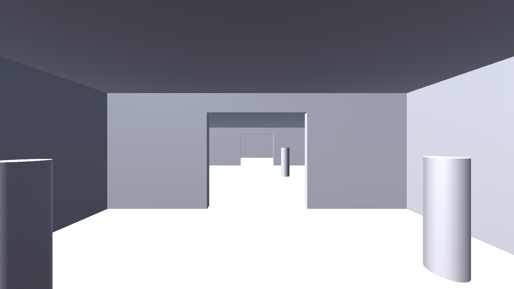

# Outpost foundations verification

The primitive outpost contains only the radio room, kitchen, and
archive/workshop. Six named anchors reserve interaction locations; they are
not final props. The scene is generated by `CommonHouse.Editor.OutpostSceneGenerator`
and saved at `Assets/CommonHouse/Scenes/OutpostBlockout.unity`.
The generator replaces that scene explicitly; it is not an import hook.

## Editor-rendered views and local traversal

The pinned Unity 6000.4.10f1 Editor rendered these images on Kvant with the
AMD Radeon RX 7900 XT / OpenGL 4.6. They are actual scene-camera captures from
the Editor, not mockups or screenshots of Editor window chrome. The cutaway
hides ceiling renderers only for that capture; first-person views retain them.
No source scene is saved by the capture operation.







The agent inspected the generated images: the first-person views show the
connected doorways and placeholder anchors; the cutaway shows the confined
footprint. Temporary neutral materials and lighting are intentional.

The capture operation moved a physical CharacterController probe from
`(-10, 0.05, 0)` through kitchen and archive checkpoints, then back through both
rooms. Each ten-unit segment completed in 100 steps. Moving toward the exterior
east wall stopped the probe at approximately `(13.555, 0.020, 0)`. This is an
observed scripted local traversal, not a human keyboard playtest.
The separate `PlayerMovementTests` exercise the actual generated player
controller, movement/look, pause suppression, room traversal, and collision.

Reproduce the graphical evidence with normal local licensing/display access:

```sh
python3 scripts/capture_outpost.py
```

The command snapshots project sources and gives the copy a unique save identity.
It uses a graphics device and fails if rendering or physical traversal fails.
PNG captures and traversal observations remain in its private evidence directory;
temporary project/save state is removed. Inspect the images in addition to the
command status. The initial capture produced images but its wrapper failed on
a reporting typo; that failed invocation was retained and the corrected command
was rerun successfully.

Graphical receipt:
`~/.local/state/common-house-unity/outpost-graphics-20260925T035143Z-dyzp4bas/`.

## Focused checks

```sh
python3 scripts/run_unity_tests.py --platform playmode --filter CommonHouse.Tests.OutpostLayoutTests
python3 scripts/run_unity_tests.py --platform playmode --filter CommonHouse.Tests.PlayerMovementTests
```

The focused layout suite passed two tests for room/anchor references, connected
capsule-sized paths, and boundary collision. Five movement tests passed,
including the actual generated scene. Native source import and the existing
PlayMode bootstrap smoke also passed. Batch tests suppress hardware input and
pointer capture; they do not interact with the owner’s desktop.

No investigation scene loop, final art, player build, or participant observation
is established by these checks. [Movement controls](../development/player-movement.md)
and [native verification boundaries](../development.md) remain separate from
future interaction and POC qualification tasks.
