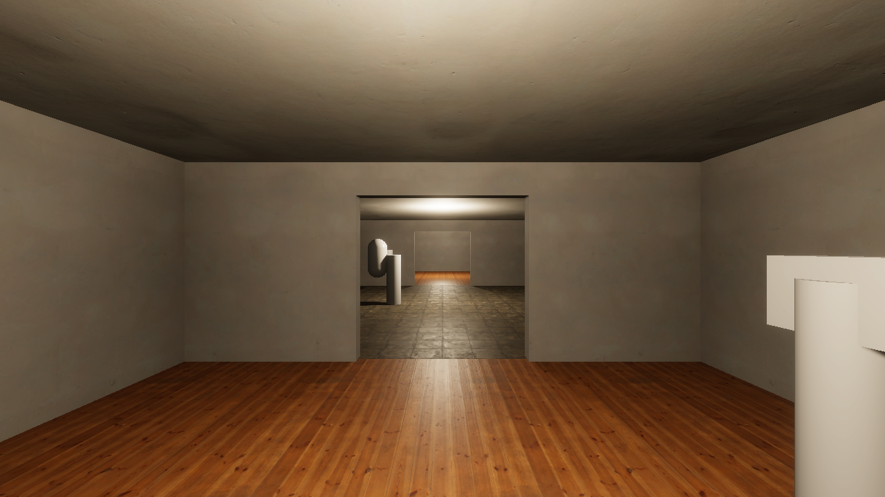
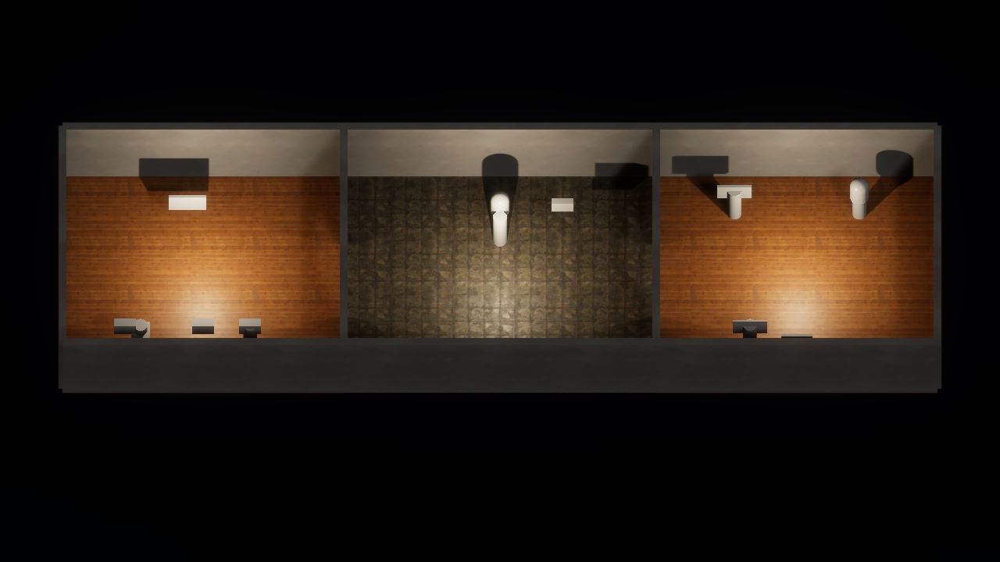
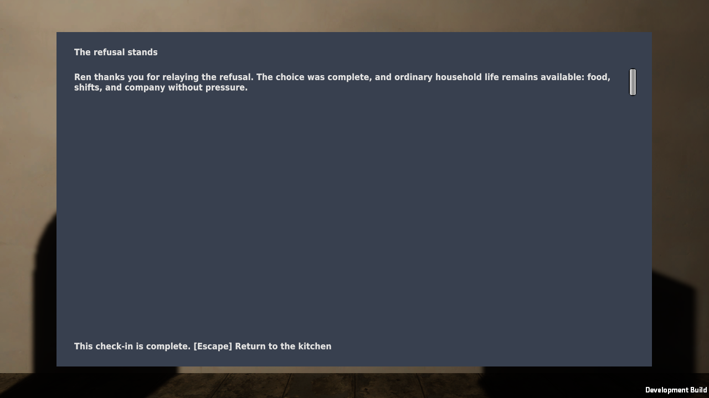

# Outpost materials verification

Issue #61 applies the CC0 scans from [style board v0.2](../design/style-board.md) to the
playable outpost's floors, walls, and ceilings. Props, doors, windows, and the interaction
placeholders are unchanged; they still use HDRP's default material.

## What changed

`CommonHouse.Editor.OutpostMaterials.Build` creates or updates four HDRP/Lit materials in
`Assets/CommonHouse/Art/Materials/`:

| Material | Scan | Used on |
|---|---|---|
| `Plaster` | `plastered_wall_04` | Outer walls, partitions, door lintels |
| `Ceiling` | `plastered_wall_04`, slightly darkened | Ceilings |
| `Floorboards` | `wood_floor_worn` | Radio room and archive floors |
| `KitchenTiles` | `worn_tile_floor` | Kitchen floor |

The materials use world-space triplanar mapping, scaled to each scan's measured size. The
blockout's primitive cubes are stretched, and tests and interaction targets depend on their
names, positions, and colliders, so the geometry is unchanged. Each scan's ARM map is repacked
into an HDRP mask map (metallic, occlusion, smoothness) and saved as a PNG in
`Assets/CommonHouse/Art/Generated/`. The PNG is rewritten only when its content changes. The
three mask maps are LFS files with `generated` entries in the
[provenance manifest](../development/asset-provenance.json).

`OutpostSceneGenerator.Generate` calls the builder and assigns the materials by room.
Regenerate with:

```sh
git lfs pull
python3 scripts/run_editor_method.py CommonHouse.Editor.OutpostSceneGenerator.Generate --copy-back
```

## Results

All results were produced on Kvant on 2026-09-28 UTC with Unity 6000.4.10f1 (AMD Radeon
RX 7900 XT, Vulkan). The source was an uncommitted tree based on `a99644b`. Evidence is under
`~/.local/state/common-house-unity/`.

| Check | Result | Evidence |
|---|---|---|
| EditMode tests | 94 passed, `-nographics` | `tests-editmode-20260928T023316Z-8ursvgjt` |
| PlayMode tests | 89 passed, `-nographics` | `tests-playmode-20260928T023420Z-9lwk6jzi` |
| `capture_outpost.py` | Passed; images inspected | `outpost-graphics-20260928T023110Z-_38uavo2` |
| `build_poc.py --target local --smoke` | Passed; aftermath screenshot inspected | `local-poc-build-20260928T023528Z-jgp0gdq0` |
| `check_provenance.py` | 15 entries | — |

The player build has 294 files totalling 297,061,124 bytes, up from 255,064,549 in the
[HDRP migration](hdrp-migration.md) build.







## Known limits

- The grey interaction placeholders now stand out against scanned surfaces. Replacing them
  with props is separate work.
- Triplanar mapping blends at edges and costs more to render than UV mapping. Frame rate was
  not measured.
- Floorboards run in the same world direction in both rooms, and each wall uses the same
  plaster tile, so repetition shows on long walls.
- Lighting is still the temporary one-lamp-per-room setup, without reflection probes or baked
  light.
- This is scripted evidence, not a human playtest.
