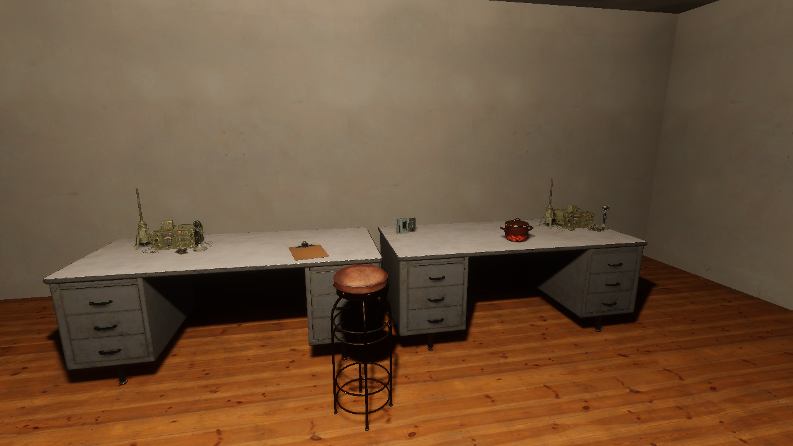
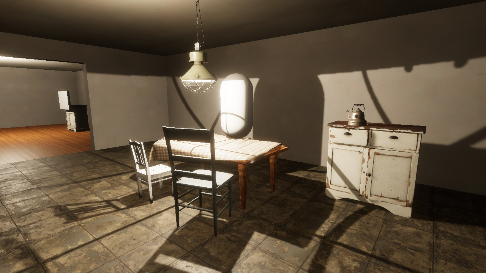
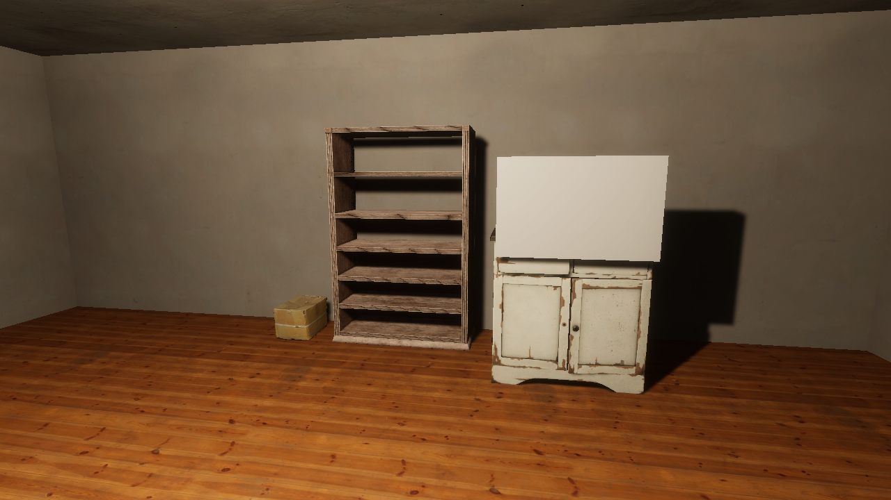
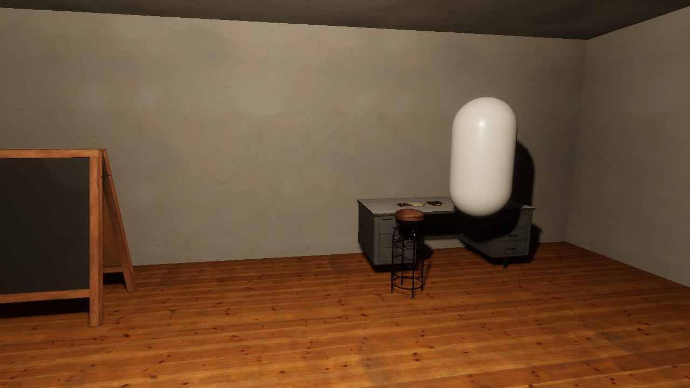
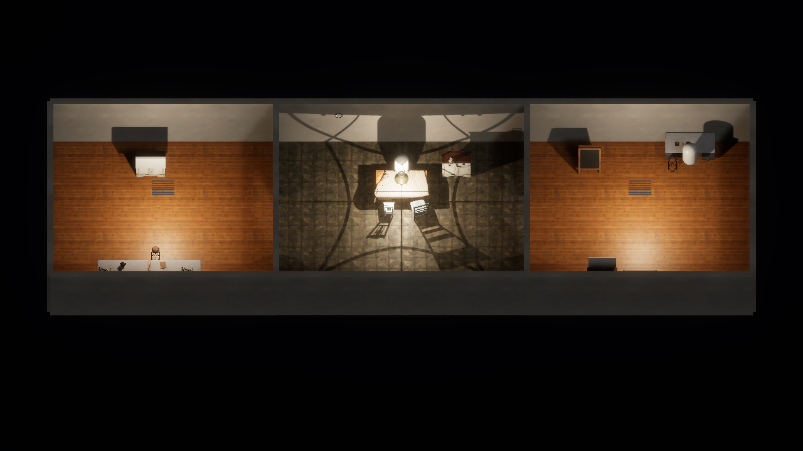

# Outpost props verification

Issue #63 replaces the outpost's grey furniture and equipment placeholders with CC0 scanned
models from Poly Haven. The owner chose scanned models on 2026-09-28 and will look for a
suitable retro-future piece if one is needed. Resident capsules and the two case-document
panels are unchanged.

## Models

| Room | Models |
|---|---|
| Radio room | Two `metal_office_desk`, two `vintage_radio_transceiver` (a receiving and a transmitting set), `pot_enamel_01`, `portable_cassette_player`, `clipboard`, `metal_stool_01`, `painted_wooden_cabinet` under Ren's note, `mounted_fluorescent_lights` |
| Kitchen | `dining_table`, `painted_wooden_chair_01`, `painted_wooden_chair_02`, `hanging_industrial_lamp`, `painted_wooden_cabinet` with `vintage_electric_kettle`, `wall_clock` |
| Archive and workshop | `wooden_bookshelf_worn`, `cardboard_box_01`, `painted_wooden_cabinet` under the roster, `standing_chalkboard_01` for the routing diagram, `metal_office_desk` as the bench with `binder_notebook`, `metal_stool_01`, `mounted_fluorescent_lights` |

Furniture and the radios use 2K maps. Small props and ceiling fixtures use 1K. The 18 models add
84 source files (about 119 MB with the earlier room scans) and 22 generated mask maps. Every
file has a provenance entry.

## How the placeholders were replaced

The PlayMode tests aim the camera at each interaction target's position from about 0.9 m. The
targets therefore keep their positions and colliders, and `OutpostSceneGenerator.Furnish` only
hides their grey meshes. The same applies to the six anchor markers. Models have no colliders:
they cannot block interaction rays, and the player can walk through furniture.

The room lamps now sit at the new fixtures. The radio room and archive panel lights are 0.4 m
below their fixtures, so some light reaches the ceiling. The kitchen pendant hangs over the
table, and an unshadowed 500 lm fill stands in for bounced light, because the shade blocks
upward light and the project has no global illumination.

`capture_outpost.py` now also renders four eye-level review views.

## Results

All results were produced on Kvant on 2026-09-28 UTC with Unity 6000.4.10f1 (AMD Radeon
RX 7900 XT, Vulkan). The source was an uncommitted tree based on `b25e25c`. Evidence is under
`~/.local/state/common-house-unity/`.

| Check | Result | Evidence |
|---|---|---|
| Python tests, including 6 for the fetch script | Passed | — |
| `check_provenance.py` | 118 entries | — |
| EditMode tests | 94 passed, `-nographics` | `tests-editmode-20260928T032818Z-c0_ah596` |
| PlayMode tests | 89 passed, `-nographics` | `tests-playmode-20260928T032932Z-koemwfeh` |
| `capture_outpost.py` | Passed; all views inspected | `outpost-graphics-20260928T032636Z-5gb45ag1` |
| `build_poc.py --target local --smoke` | Passed; aftermath screenshot inspected | `local-poc-build-20260928T033100Z-kipz7dls` |

The player build has 294 files totalling 484,686,005 bytes, up from 297,061,124 with room
materials only. Texture resolution and import compression have not been tuned for size.

## Known limits

- Residents are still capsules, and the resident at the kitchen table catches the pendant's
  light. Ren's note and the roster are still plain panels.
- The radios are a military-style field transceiver, not purpose-made retro-future equipment.
- The bookshelf is empty, and the rooms are sparse.
- Furniture has no collision.
- The layout was set by hand from the existing target positions. It has not been reviewed in
  play.
- Frame rate, memory, and load time were not measured.
