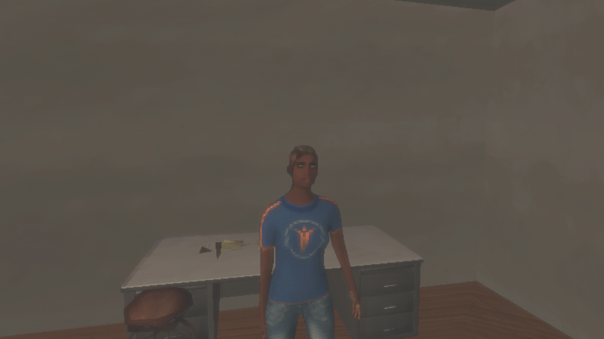
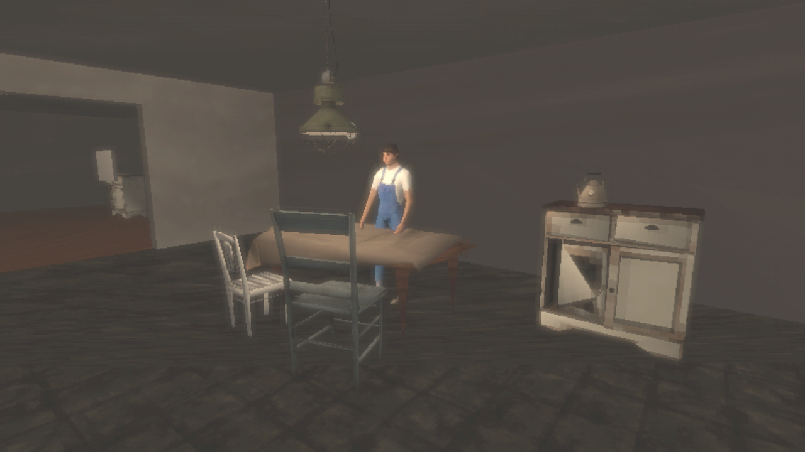

# Resident animation verification

Issue #83 animates the residents with Mixamo animations
([D-25](../design/decisions-and-open-questions.md)). The owner downloaded the Mixamo library
(1,254 animations and 22 packs, 1.5 GB) as FBX for Unity without skin, and asked for the useful
animations to be picked and the rest stored outside the repository.

## What was kept

58 clips, 46.9 MB, suited to a household radio outpost:

- Standing and unease: idles, looking around, nervously looking around, yawning, stretching.
- Sitting: idle, talking, drinking, laughing, disapproving, dazed, sitting down and standing up,
  and typing.
- Conversation: talking, acknowledging, agreeing, nodding, "no", shrugging, thinking, pointing,
  waving, dismissing, disappointed, arguing, and looking away.
- Household and desk work: drinking, writing, texting (to stand in for a handheld radio),
  carrying, the filing cabinet, searching, opening a lid or door, kneeling to inspect, wiping
  sweat, and bartending.
- Walking: walking, starting and stopping, and turns.

Combat, dance, sport, creature, and weapon animations were left out. The whole download,
including the kept clips, is in `~/Documents/Common House Assets/Mixamo/` on Kvant, with a README
on the licence and the list of kept clips. It was moved out of the main checkout, where it had
been untracked.

## Results

On Kvant, 2026-09-29 UTC. The source was an uncommitted tree based on the retro-characters branch.

| Check | Result | Evidence |
|---|---|---|
| `import_mixamo.py` | 58 clips with `licensed` provenance | — |
| `check_provenance.py` | 231 entries | — |
| New PlayMode test `ResidentAnimationTests` | Passed: both residents are humanoid and loop their own idle (`breathing-idle`, `neutral-idle`) in play | `tests-playmode-20260929T195101Z-8ip8rybt` |
| PlayMode suite | 90 passed | `tests-playmode-20260929T195444Z-i8hf011d` |
| EditMode suite | 94 passed | `tests-editmode-20260929T194436Z-2cvt8jax` |
| `capture_outpost.py` | Passed; residents posed by sampling their idle; inspected | `outpost-graphics-20260929T194300Z-ej2rm3_5` |
| `build_poc.py --target local --smoke` | Passed; player log has no errors; 264,938,255 bytes | `local-poc-build-20260929T194725Z-mjhhhxe3` |

Animators do not run in edit mode. The first capture still showed the A-pose, so captures now
sample each resident's default clip with `AnimationMode`. The PlayMode test checks the real
play path. One full PlayMode run was killed partway through; the rerun above passed.

## Known limits

- Residents only idle. Conversation, sitting, and household clips are imported but not yet
  triggered by play.
- Idles loop in place. Nothing drives walking or turning.
- The library was downloaded by the owner's script. Adobe's terms on automated access were raised
  with the owner; this record does not settle them.
