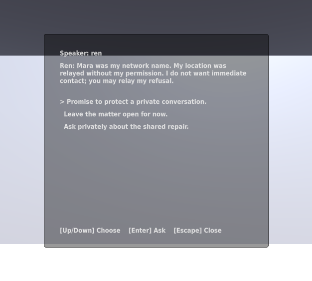
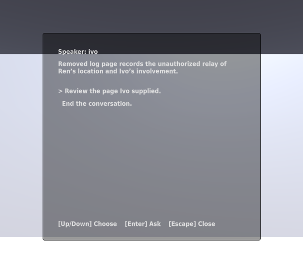
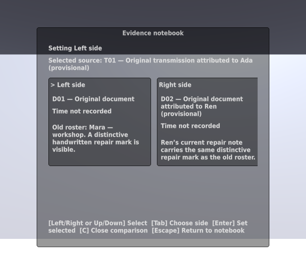
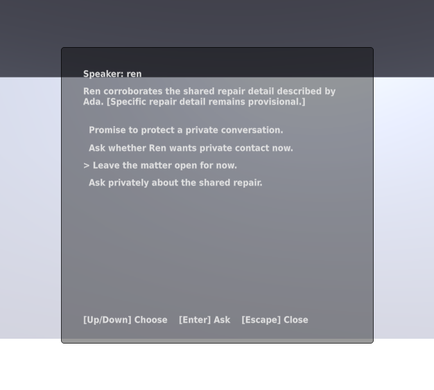
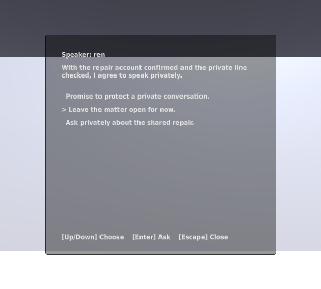

# Resident evidence verification

Issues #19–#22 connect D01/D02, Ivo's D03 page, both shared-repair accounts,
and Ren's private identity/consent conversation to real outpost targets.
Ren is in the archive; Ivo is in the kitchen. Resident dialogue has no global
keyboard shortcut. The original generic inspection sample is replaced by the
canonical repair note.

## Executed checks

On Kvant, Unity 6000.4.10f1 passed 89 EditMode and 55 PlayMode tests:

- `tests-editmode-20260925T043429Z-ek0im3ad`
- `tests-playmode-20260925T043555Z-umejvhcu`

Focused scene fixtures passed: RosterEvidenceTests (3), MissingPageTests (5),
CallerCorroborationTests (1 scenario exercising both orders), RenConsentTests
(5). These load the generated outpost and use its focus/activation interfaces.
Rereading and comparison remain separate from acquisition. E03 remains a
hypothesis, E06 requires both accounts, and neither grants consent. Ren's
initial refusal authorizes R2; only the later eligible question grants private
contact. A repeat of an earlier event cannot downgrade that agreement.

Initial full-suite failures exposed test-fixture geometry intersecting the
new generated resident colliders. Constructed inspection fixtures now use
separate distant test origins; their occlusion/range assertions remain intact.
The final suite above passed. Failed receipts remain private.

## Rendered text

The actual Game-view capture `panel-graphics-20260925T043658Z-evt80zkj` was
inspected. It uses scripted interactions and disposable seeded data. Names,
wording, and the repair detail remain provisional; no voice assets are needed.

## Evidence boundaries

The Python regression suite and covered modules are unchanged from the
successful isolated T3 run for PR #41; Git comparison confirms this. The
changed capture tool was executed against the graphical Editor. Document
links were checked locally after adding this report.

Native runners removed temporary projects and unique save directories; private
receipts remain under `~/.local/state/common-house-unity/`. Send confirmation,
aftermath, reload, complete-route accessibility, and desktop build qualification
remain later issues. This batch is not a human playtest or full POC evaluation.
