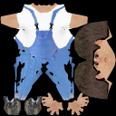
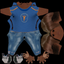
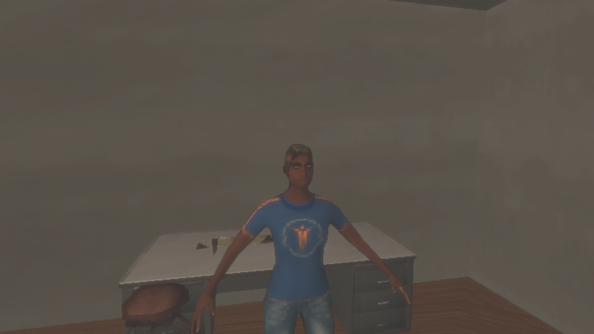
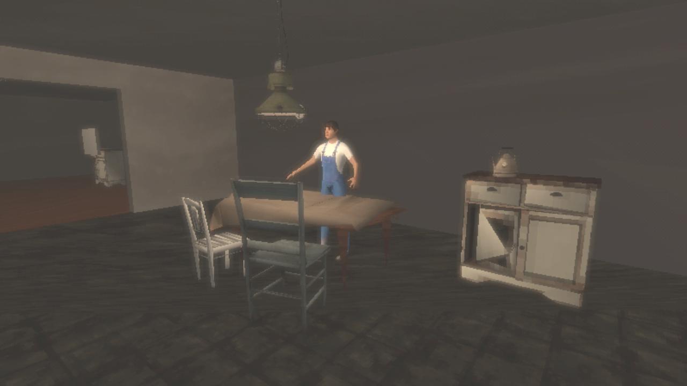

# Retro characters verification

Issue #81 puts low-poly residents in the playable outpost, in the style of the
[D-24](../design/decisions-and-open-questions.md) references. The owner dropped photo faces, which
were only for the GoldenEye experiment, and asked for "models like the other games I listed".

## What was built

`python3 scripts/characters.py retro` turns each character recipe into MPFB's `proxy741` body
(730 faces) with the detailed character baked onto one 128 px texture: skin, face, clothes, shoes,
and hair. See [characters](../development/characters.md#retro-characters). Two test recipes stand
in for the residents: `test-resident-01` at Ivo's position in the kitchen, and a new
`test-resident-02` at Ren's position in the workshop. They are pipeline tests, not resident
designs, and the names and positions are placeholders. The capsules keep their colliders and
dialogue targets.

## Problems found and fixed

- MPFB masks the proxy's faces under clothes, for layered clothing. The first bake left those
  areas black. The bake now keeps the whole body.
- A second outpost build found no materials on the decimated props. After remapping, Unity no
  longer lists them as embedded, so their textures dropped out of provenance. `RetroLook` now also
  reads the importer's remaps.
- `bob02` hair is dyed teal and read as white at this size. The second recipe uses `long01`.

## Results

On Kvant, 2026-09-29 UTC, Unity 6000.4.10f1 (RX 7900 XT, Vulkan). The source was an uncommitted
tree based on the retro-look branch (`t3code/retro-look`).

| Check | Result | Evidence |
|---|---|---|
| `characters.py retro` | 2 characters, 730 faces, 128 px | — |
| `build_outpost.py` | 16 models, 23 textures | — |
| `capture_outpost.py` | Passed, including a new resident close-up; inspected | `outpost-graphics-20260929T033244Z-rsx6j8ao` |
| EditMode tests | 94 passed | `tests-editmode-20260929T033410Z-sb9xbfy5` |
| PlayMode tests | 89 passed | `tests-playmode-20260929T033509Z-97yxbch8` |
| `build_poc.py --target local --smoke` | Passed; player log has no errors; 256,730,651 bytes | `local-poc-build-20260929T033617Z-b7nuwzf3` |
| `check_provenance.py` | 173 entries | — |

## Known limits

- The residents stand in MPFB's A-pose. There is no animation.
- Some bake rays miss, leaving small dark patches, for example under the arms. Eyes bake as
  bright whites.
- Long hair is painted onto a bald head shape, so it reads as short hair.
- The texture is baked, not hand-painted. Era artists exaggerated features and shading in the
  texture itself.
