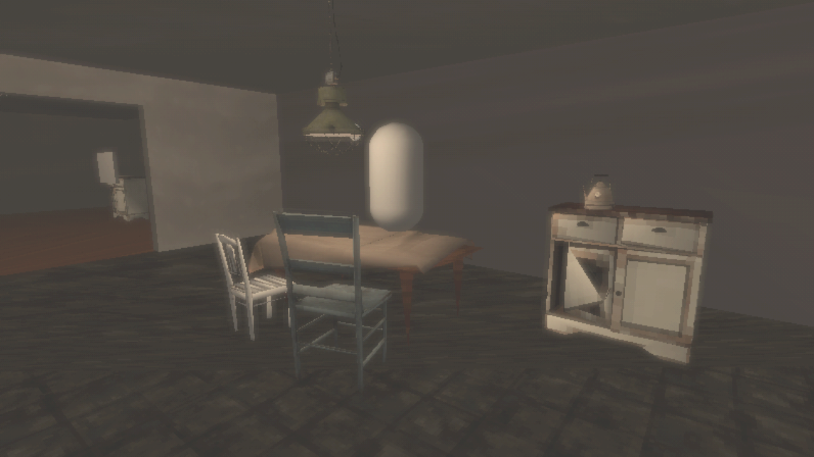
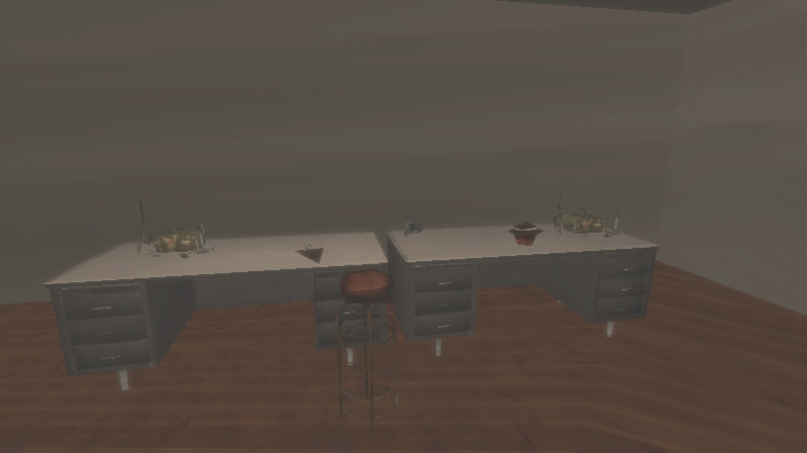
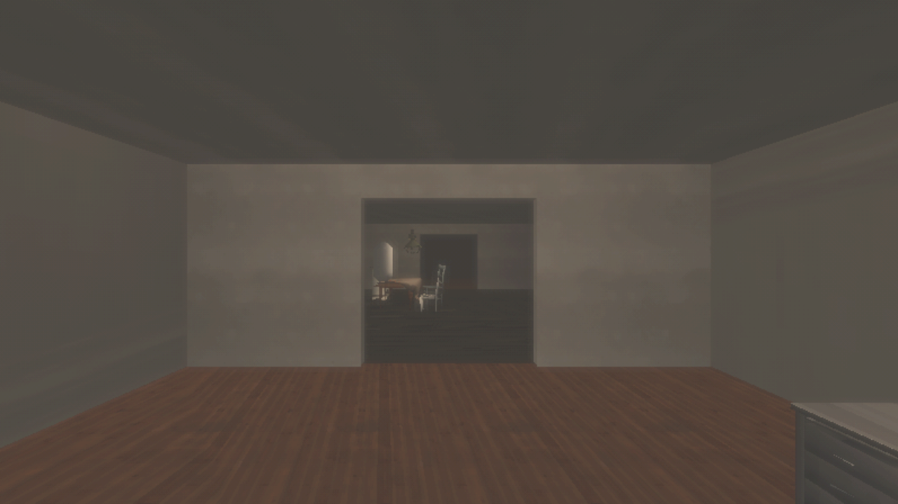
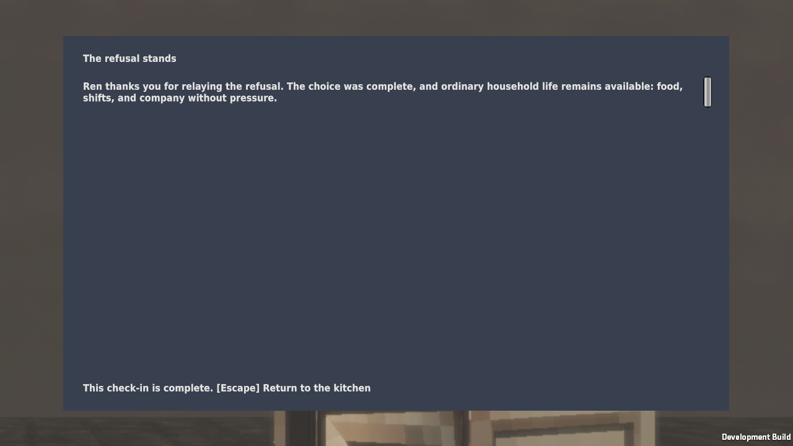

# Retro look verification

Issue #79 makes the [D-24 look](../development/look.md) the playable one. Earlier, it existed only in
review scenes on experimental branches.

## Results

On Kvant, 2026-09-28 UTC, Unity 6000.4.10f1, AMD Radeon RX 7900 XT (Vulkan). The source was an
uncommitted tree based on `0a5b674`. Evidence is under `~/.local/state/common-house-unity/`.

| Check | Result | Evidence |
|---|---|---|
| `build_outpost.py` | 16 decimated models, 23 textures, scene regenerated | `editor-method-20260928T224451Z-4js829ts` |
| `capture_outpost.py` | Passed; views inspected at 448 lines scaled to 720 | `outpost-graphics-20260928T224904Z-dbq77qfv` |
| EditMode tests | 94 passed | `tests-editmode-20260928T225022Z-xg4ebn76` |
| PlayMode tests | 89 passed | `tests-playmode-20260928T225125Z-5ei_6c8k` |
| `build_poc.py --target local --smoke` | Passed; player log has no errors; screenshot inspected | `local-poc-build-20260928T225531Z-wu7azx6h` |
| `check_provenance.py` | 169 entries | — |

The first build smoke passed while the player logged "Missing shader" for both post-processes,
because nothing referenced their shaders and the build dropped them. They moved to
`Look/Resources/`, and the rebuilt player logs no errors. The smoke test does not check the player
log for errors. That gap remains.

The player build has 296 files and 256,356,951 bytes, down from 484,686,005 in the
[outpost props](outpost-props.md) build. The scene no longer references the full-resolution
materials and models.

## Known limits

- The residents are still capsules. The MPFB characters and face photos are not in the playable
  scene yet.
- Textures are shrunken scans, not purpose-made low-resolution textures.
- Decimation artefacts remain, such as the cabinet door's diagonal triangle.
- Dynamic resolution in play was checked only through the smoke screenshot. Frame rate was not
  measured.
- This is scripted evidence, not a human playtest.
