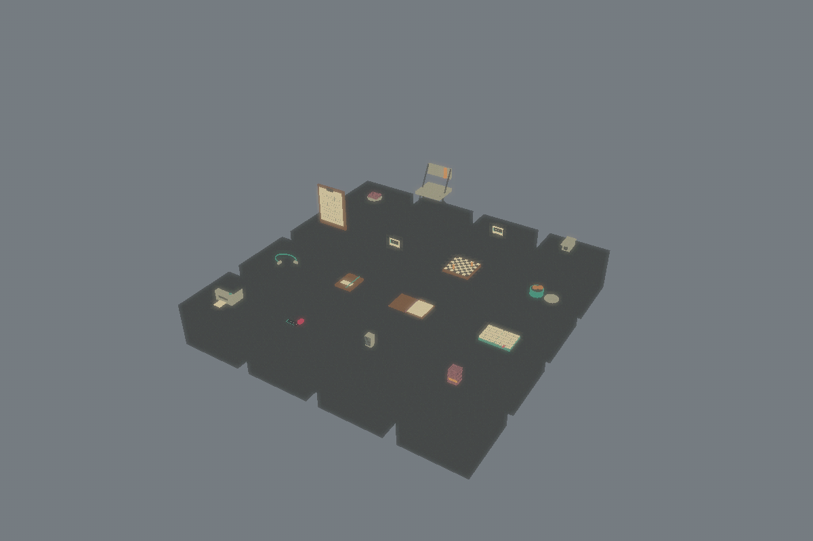
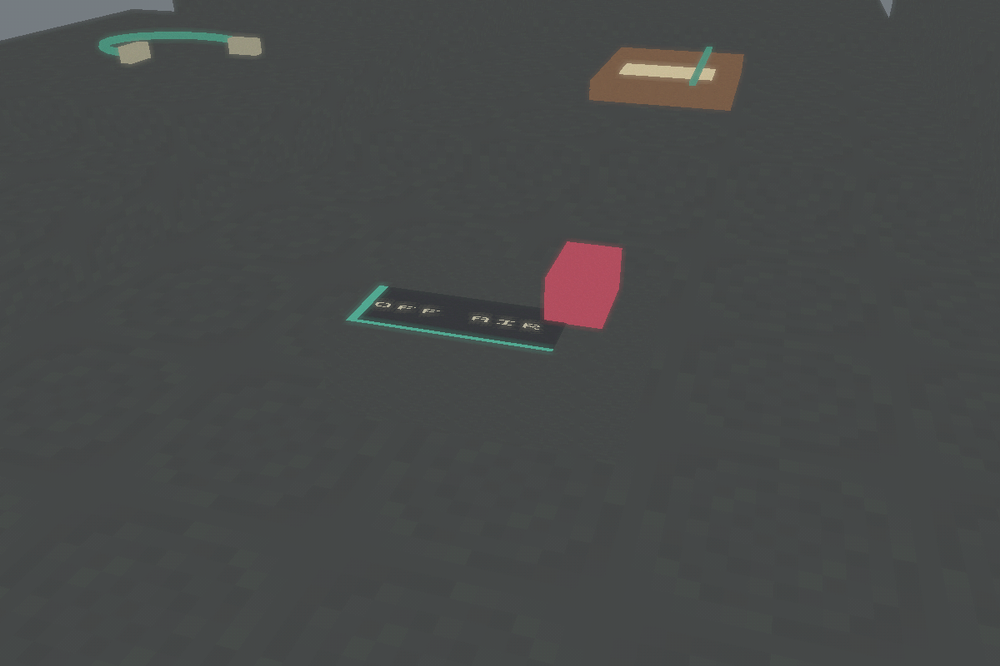
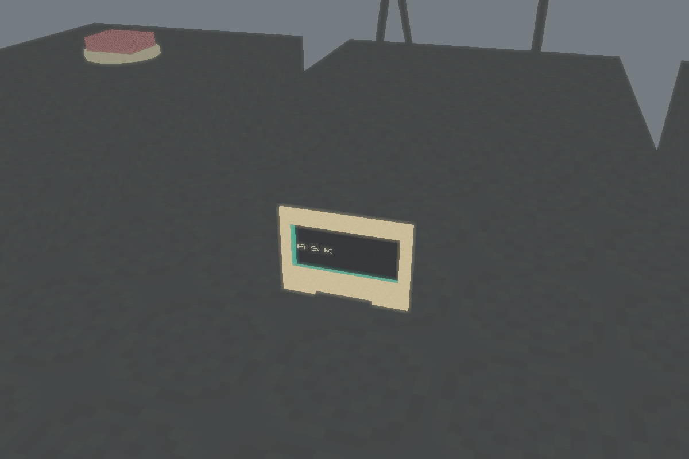

# First Season 1 prop kit verification

Date: 2026-09-30. Scope: [issue #103](https://git.subcult.tv/PatrickFanella/the-common-house/issues/103). Source base: merged `main` at `452edf9`; branch `t3code/season-one-prop-kit`. [Asset inventory](../design/season-01-asset-inventory.md) and [generation guide](../development/season-one-assets.md) describe the delivered assets and future work.

## Delivered and observed

The licensed Unity `6000.4.10f1` Editor generated 16 reusable prefabs, 14 original 64×64 textures, 14 shared materials, two saved meshes, and a separate review scene. Textures are stored through Git LFS with generated provenance. The largest kit file is the text chess-board prefab at 185,303 bytes.

The narrow wrapper returned only `Art/SeasonOne` and `SeasonOneAssetReview.unity`. After generation, hashes for 24 ProjectSettings files and the existing intro and outpost scenes matched the recorded input snapshot. The owner's pre-existing Editor changes were present in the verification snapshot, remained untouched in the checkout, and are excluded from this PR.

| Check | Observed result | Retained evidence |
|---|---|---|
| Native generation and export | Passed, 16 prefabs and 14 textures | `~/.local/state/common-house-unity/season-assets-20260930T052405Z-_lh4r11o/` |
| Focused graphical EditMode fixture | 4 passed, 0 failed, 0 skipped | `~/.local/state/common-house-unity/tests-editmode-20260930T053003Z-4hvatp1x/` |
| Narrow-export regression tests in isolated T3 test container | 4 passed | Tests cover preservation of owner settings, rejection before copying an unexpected file, incomplete output, and a symlink |
| Provenance | 303 entries cover all sourced and LFS assets | `python3 scripts/check_provenance.py` |
| Binary size and LFS pointers | Passed | `python3 scripts/check_binary_sizes.py` |
| Document links and staged whitespace | Passed | `python3 scripts/check_docs.py`; `git diff --cached --check` |

The graphical fixture rendered eight views. All eight final images were inspected, including the four prop rows and close views of OFF AIR, ASK, and the camera. The first run's card close-up aimed at the roster board; the capture target was corrected and the focused fixture rerun. The final view shows the intended card and readable forward-facing lettering.

The open folder exposes a blank insert; the closed version has an elastic closure and no visible insert. The microphone cover hides the grille and creates a distinct cloth silhouette. The disconnected patch lead has two free plugs. The shared-table objects remain ordinary household items alongside the broadcast equipment.

The final native runner removed its disposable project and save namespace. Raw logs, result XML, source hashes, and captures remain in the evidence directory. The original owner Editor was not stopped or restarted.

## Rendered review

## Qualification limits

These are provisional presentation prefabs with saved references and inspected Editor renders. They have no episode controllers, collisions, audio, character performance, consent logic, or automatic network effects. The review scene remains outside playable build settings. This pass does not qualify an episode, a new Linux player build, or a human playtest. Source-bound media settings and branch-aware household placement remain the next production work.
